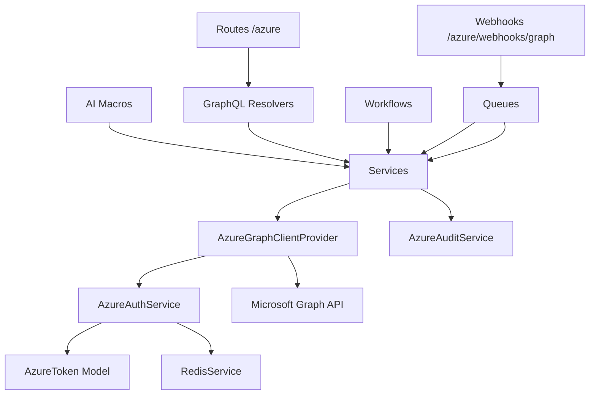

# reactory-azure — Capability Audit

> **Status:** audit of `core.ReactoryAzure@1.0.0` against the Microsoft Graph / Azure
> capability surface, benchmarked against `google.ReactoryGoogle@1.0.0`.
> **Audit date:** 2026-11-08
> **Scope:** the module at `src/modules/reactory-azure` only. No changes were made to code
> during the audit. No server restart was performed.
> **Companion document:** `docs/implementation-plan.md`

---

## 0. Status of this audit — after AZ-18

**This document is a historical baseline, not a description of the current module.** It was
written against the pre-rebuild module — 6 source files, 384 lines, nothing executable — and is
retained because every ticket in `docs/implementation-plan.md` cites it. All nineteen tickets
have since merged.

For what the module does today read **`AGENT.md`**; for how to register and operate it read
**`docs/operations.md`**.

### Defect status

| Defect | Severity | Status | Resolved by |
|---|---|---|---|
| D1 Graph client factory references undeclared identifiers | Blocking | **Resolved** | AZ-01 — single construction site in `services/graph/AzureGraphClientProvider.ts` |
| D2 Module registers nothing | Blocking | **Resolved** | AZ-01 — 16 services, 4 models, 11 type files, 5 queues, 9 forms |
| D3 Interface and implementation disagree | Blocking | **Resolved** | AZ-01 |
| D4 Invalid implementation signature, optionality drift | Blocking | **Resolved** | AZ-01, AZ-19 (`types.d.ts` narrowed to the shim that remains) |
| D5 Missing type dependency | Blocking | **Resolved** | AZ-01 — `@microsoft/microsoft-graph-types` installed |
| D6 `sendEmail` reports failure as success | Blocking | **Resolved** | AZ-01 — the shim rejects with the Graph code; AZ-19 owns its retirement |
| D7 `getEmails` swallows all errors and returns `[]` | High | **Resolved** | AZ-01 — rejects instead of returning an empty page |
| D8 No pagination anywhere | High | **Resolved** | AZ-01 — `requestAll` / `delta` with a hard page bound that throws |
| D9 Tasks target a legacy surface | High | **Resolved** | AZ-06 — `/me/todo` on v1.0 only; the beta path is unreachable from the new surface |
| D10 No authentication or token lifecycle | High | **Resolved** | AZ-01 — PKCE, encrypted vault, refresh, legacy bridge |
| D11 Storage scaffold written against the wrong SDK major | Medium | **Resolved** | AZ-16 — Blob Storage v12 data plane |
| D12 No tests, no lint, no type-safety net | Medium | **Resolved** | AZ-01 onward — 33 suites under `__tests__/` |
| D13 Documentation asserts capability that does not exist | Low | **Resolved** | AZ-18 — `AGENT.md` rewritten from the code; `docs/operations.md` added |
| D14 Namespace does not match the module's subject | Low | **Accepted by decision** | §9.4 — module FQN stays `core.ReactoryAzure@1.0.0`; components use `azure.*` |
| D15 Version drift across four artefacts | Low | **Resolved** | AZ-03 — registry metadata aligned on `1.0.0` |

### What is *not* resolved, and should not be

§7's capability gaps (G1–G8) are properties of Microsoft Graph, not defects in this module.
They were true before the rebuild and remain true after it: no server-side Word body editing,
PDF conversion capped at 2 MB, no assignee on a To Do task (Planner owns assignment),
`expand=fields` without a dollar prefix, no thread resource, and differing attachment, recurrence
and subscription-lifetime models. They are restated in `AGENT.md` → "What this module cannot do"
and `docs/operations.md` §11.

**This section is a documentation status update, not a re-audit.** No code was changed by AZ-18,
no service was edited, and no server restart was performed.

---

## 1. Executive summary

The module is not a lightweight integration. It is a **non-executing reference stub**.

It contains 6 tracked source files totalling **384** lines, of which **252** are non-comment
code — nearly all inside a single object literal that cannot execute. The storage scaffold is
**88** lines, of which **62** are commented out.

Three facts settle the question of capability:

1. **Nothing is registered.** `services/index.ts` and `workflows/index.ts` both `export
   default []`. The module contributes zero services, zero models, zero GraphQL types, zero
   resolvers, zero forms, zero routes, zero middleware, zero CLI commands and zero AI macros.
   The `MSGraph` object is unreachable **through the service registry** — but it is *not* dead
   code: three files in `reactory-core` import it directly (`resolvers/Emails/UserEmails.ts:9`,
   `resolvers/User/ProfileResolver.ts:6`, `services/EmailService.ts:9`). That distinction is
   load-bearing for the rebuild; see D2.
2. **The one Graph client factory cannot construct a client.** `getAuthenticatedClient()`
   calls `Client.init(...)`, but `Client` is never imported or declared anywhere in the file.
   The first call to any method raises `ReferenceError: Client is not defined`.
3. **There is no authentication.** Every method takes a raw `accessToken: string` argument.
   The module contains no OAuth flow, no token store, no refresh, no encryption, and no
   consent handling. `@azure/msal-browser` — a **browser** library — is declared as a
   dependency of a **server** module.

Against the reference implementation the reachable-surface gap is **0 vs 10** registered
services, **0 vs 8** GraphQL resolvers, **0 vs 4** models and **0 vs 11** AI macros — and
roughly **1 : 24** on live lines of TypeScript (252 vs 6 127, excluding tests, blanks and
comments).

The good news: the *shape* of the target is unambiguous, because `reactory-google` is a
complete, reviewed, working precedent for exactly this class of module. Microsoft Graph is
at least as capable as Google Workspace for mail, calendar, files, workbooks, contacts and
tasks, and it is materially **more** capable in three areas where Google has no in-module
equivalent: **Teams**, **SharePoint**, and **Azure Blob Storage**.

The recommendation is a **rebuild along the Google module's architecture**, delivered as a
walking skeleton first (auth + one read path + tests), then one service per ticket. Section 8
records the places where Azure genuinely cannot match Google, so the parity claim stays honest.

---

## 2. Method and evidence base

| Evidence | Detail |
|---|---|
| Files read in full | `index.ts`, `package.json`, `types.d.ts`, `services/graph.ts`, `services/index.ts`, `storage/index.ts`, `workflows/index.ts`, `AGENT.md`, `README.md` |
| Consumers outside the module | `reactory-core/resolvers/Emails/UserEmails.ts`, `reactory-core/resolvers/User/ProfileResolver.ts`, `reactory-core/services/EmailService.ts` — all import `reactory-azure/services/graph` |
| Repository state | `reactory-azure` is its **own git repository** (`git@github.com:reactorynet/reactory-azure.git`), nested inside the express-server tree. It is not a submodule of `reactory-express-server` — `git ls-files -s src/modules/reactory-azure` returns nothing |
| Working tree | branch `master`, HEAD `c962956`. **Not clean:** `git status --porcelain` reports `?? docs/` — the two documents under review are untracked, so a worktree created from `origin/master` will not contain them |
| Installed SDKs | `@azure/storage-blob@12.23.0`, `@azure/storage-file-share@12.23.0` present in the server `node_modules`; `@microsoft/microsoft-graph-client` and `@microsoft/microsoft-graph-types` **absent** |
| Registry | `available.json`, `enabled-reactory.json`, `installed.json` all declare `"fqn": "core.ReactoryAzure@1.0.0"`, `"license": "MIT"` and a `"shop"` URL |
| Loader | `src/modules/helpers/moduleImportFactory.ts` generates `__index.ts` from `moduleEntry`; the registry `fqn` is used only to derive an import variable name |
| Test harness | `src/modules/reactory-reactor/scripts/ai/run-worktree-tests.js` with `--module-root` — the supported verification recipe for module worktrees |
| Prior review | Quality Quinn, 2026-10-19, `REACTORY-302016408/20261018/2254215113` — two defects reproduced below as D3 and D6 |

---

## 3. Current inventory

> **Pre-rebuild baseline.** The inventory below describes the module at audit time and is kept
> for the historical record. It is not the current file list — see `AGENT.md` → "Services",
> "Models" and "Tests" for what exists now.

| File | Lines | Declares | Actual runtime capability |
|---|---:|---|---|
| `index.ts` | 31 | `IReactoryModule` with `nameSpace: 'core'`; all contribution arrays empty | Loads, contributes nothing |
| `services/graph.ts` | 229 | `MSGraph` object with 9 methods | Every method rejects with `ReferenceError`; imported directly by three `reactory-core` files |
| `services/index.ts` | 2 | `export default []` | — |
| `storage/index.ts` | 88 | `AzureBlobStorage` class | Constructor empty; every method commented out; 62 of 88 lines are comments |
| `workflows/index.ts` | 2 | `export default []` | — |
| `types.d.ts` | 32 | `Reactory.MicrosoftGraph.Service.IMicrosoftGraph` — 8 declared methods | Does not compile (see D3, D4, D5) |
| `AGENT.md` | 58 | documentation | Describes capability the code does not have |
| `README.md` | 3 | "Example Only" | Accurate |

---

## 4. Defects, severity ranked

> **All defects are closed.** See §0 for the per-defect resolution table. The evidence below is
> the pre-rebuild baseline and is retained because the tickets cite it.

Each defect lists the evidence and the consequence. "Consequence" means observable platform
behaviour, which is what matters for prioritisation.

### D1 — Blocking: Graph client factory references undeclared identifiers

`services/graph.ts:12` calls `Client.init({...})` and `:38` calls
`.responseType(ResponseType.RAW)`. The file's complete import list is `isomorphic-fetch`,
`moment`, `{ response } from "express"`, `logger`, `ApiError`, `Reactory` types and `Stream`.
Neither `Client` nor `ResponseType` is imported, required or declared.

**Consequence:** every method on `MSGraph` rejects with `ReferenceError: Client is not defined`.
The `getAuthenticatedClient()` call precedes each `try` block — `getProfileImage` at `:29`
before `try` at `:31`, `getUserDetails` at `:66` before `:74`, `getEmails` at `:107` before
`:109` — or there is no `try` at all, as in the four task methods. The single exception is
`sendEmail`, whose call at `:217` is *inside* its `try`: it swallows the error and returns the
Express `response` export instead (D6).
`@microsoft/microsoft-graph-client` is also not installed and not declared in `package.json`.

### D2 — Blocking: the module registers nothing

`services/index.ts` is `export default []`. `index.ts` spreads that empty array into
`services`. `index.ts` does *declare* `graphDefinitions` (`Resolvers: {}`, `Types: []`),
`models`, `forms`, `cli`, `clientPlugins`, `translations`, `pdfs`, `passportProviders` and
`grpc` — all empty or null. Genuinely absent: `routes`, `middleware` and `reactor`.

**Consequence:** the Graph wrapper is unreachable **through the service registry**. No
resolver, workflow step, macro or form obtained through `context.getService()` can reach it.
But it is *not* dead code: `reactory-core` imports `services/graph` directly from three
files — `resolvers/Emails/UserEmails.ts:9,22`, `resolvers/User/ProfileResolver.ts:6,223,254`
(the Microsoft sign-in/profile path) and `services/EmailService.ts:9` (whose import resolves
even where its use is commented out). Deleting the file would break the host server's build
from a repository this work does not operate in. This is why the rebuild keeps it as a shim
rather than removing it.

### D3 — Blocking: interface and implementation disagree

`types.d.ts` declares 8 methods. `graph.ts` implements 9 — `getEmails` is present at `:105`
but absent from the interface. Because `const MSGraph: IMicrosoftGraph = {...}` annotates the
literal, TypeScript reports **TS2353** at the object literal (excess property) and **TS2339**
at any consumer that calls `getEmails`. `getEmails` is also one of only two methods the core
platform actually calls.

### D4 — Blocking: invalid implementation signature, and optionality drift

`services/graph.ts:167`:
```ts
async createTask(accessToken: string, subject: string, assignedTo = null,
                 startDate: moment.Moment, dueDate: moment.Moment,
                 timeZone = 'South Africa Standard Time') {
```
`assignedTo = null` is optional, and is followed by the required `startDate` and `dueDate` →
**TS1016**, "A required parameter cannot follow an optional parameter".

Second, smaller defect in the same pair: `types.d.ts:20` declares `assignedTo: string` —
required — while the implementation defaults it to `null`. The interface and the
implementation disagree on optionality as well as on `getEmails` (D3).

(An earlier revision of this audit attributed TS1016 to `types.d.ts`. It does not arise
there: a default initialiser is not legal in an interface method signature, and the interface
correctly lists every parameter as required.)

### D5 — Blocking: missing type dependency

`types.d.ts:2` imports `@microsoft/microsoft-graph-types`. The package is not in
`package.json` and is not installed — **TS2307**. The module also has no `tsconfig.json`, so
nothing enforces any of D3–D5 in a build; the errors are latent until someone compiles.

### D6 — Blocking: `sendEmail` reports failure as success

```ts
import { response } from "express";          // :4
...
} catch (msGraphError) {
  logger.error(`Could not send the email due to an error ${msGraphError}`);
}
return response;                              // :225 — the Express module export
```
Two defects in four lines. `Client.init` throws inside the `try` (D1), the throw is swallowed,
and the method returns the Express `response` **export object** — a truthy value. Combined with
the local `const response` declared inside the `try` (which is block-scoped and does not shadow
the return), a failed send is indistinguishable from a successful one to every caller.

**Consequence:** silent data loss. This is the most dangerous defect in the module because it
fails open in a user-visible way.

### D7 — High: `getEmails` swallows all errors and returns `[]`

`graph.ts:105-131` wraps the entire body in `try/catch`, logs at `debug`, and returns the
initialised empty array. A 401, a 429, a revoked consent and a genuine empty inbox are
reported identically. There is no error propagation to the resolver or workflow layer.

### D8 — High: no pagination anywhere

`/me/messages`, `/me/events` and `/me/outlook/tasks` are all single-page reads. Graph returns
a page and an `@odata.nextLink`; nothing follows it. Mail's default page size is small, so
"get my emails" returns a fraction of the mailbox with no indication that more exists. There is
no `$top`, no `$skiptoken`, no `Prefer: odata.maxpagesize`, and no delta support.

### D9 — High: tasks target a legacy surface

All four task methods use `/me/outlook/tasks` on the **`beta`** endpoint. That is the legacy
Outlook tasks model, retained for compatibility. Microsoft's current, generally-available task
surface is **Microsoft To Do**: `/me/todo/lists`, `/me/todo/lists/{id}/tasks`, with
`checklistItems`, `linkedResources` and `recurrence` in `v1.0`. The `assignedTo` concept the
current code passes does not exist in To Do at all — task assignment is a **Planner** feature
(`/planner/tasks` with `assignments`).

**Consequence:** the endpoint has returned no data since **20 August 2022** — the Microsoft
reference states verbatim: *"The Outlook tasks API is deprecated and stopped returning data on
August 20, 2022. Use the To Do API instead."* So this is not a drift risk; it is four methods
that cannot return a task at all. It compounds with D1 and D7: even after the client factory is
fixed, these four methods would still be asking a retired endpoint.

### D10 — High: no authentication or token lifecycle

There is no OAuth flow. Every method accepts a caller-supplied `accessToken`. There is no
token store, no refresh, no expiry handling, no revocation, no scope management, no consent
tracking and no encryption at rest. `@azure/msal-browser@3.19.0` is a browser library; a
server module needs `@azure/msal-node`'s `ConfidentialClientApplication`, or a direct
authorization-code implementation.

**Consequence:** the module can only work if some other component hands it a live token, and
nothing in the platform does. This is the reason the module has never functioned end to end.

### D11 — Medium: storage scaffold is written against the wrong SDK major version

`storage/index.ts` is entirely commented out, and the commented code uses `StorageURL`,
`ShareURL`, `ServiceURL`, `ContainerURL`, `DirectoryURL`, `FileURL`, `Aborter` and
`StorageURL.newPipeline`. Those are **v10** APIs. The installed package is
`@azure/storage-file-share@12.23.0`, whose exports are `ShareServiceClient` / `ShareClient` /
`ShareDirectoryClient` / `ShareFileClient`, with `AbortSignal` replacing `Aborter`. Verified
against the installed package: `Aborter`, `StorageURL`, `ShareURL`, `ServiceURL`,
`ContainerURL`, `DirectoryClient` and `FileClient` are all `undefined` at the top level. The
one live import, `AnonymousCredential`, does exist in v12, so the file compiles while
describing an API that no longer exists.

### D12 — Medium: no tests, no lint, no type-safety net

There is no `__tests__/`, no `jest` configuration, no `tsconfig.json` and no ESLint config in
the module. Compare `reactory-google`, which ships 7 suites (`auth-resolver`, `di-binding`,
`macros`, `services`, `userId-arity`, `utils`, `workflows`).

### D13 — Low: documentation asserts capability that does not exist

`AGENT.md` documents a nine-operation Graph surface as if it were live, and describes
"service exports are currently an empty array — Graph operations are used internally", which
inverts the truth: nothing internal calls them either. It also lists `@azure/msal-browser` as
a dependency without flagging that it is the wrong library for a server context, and its
Directory Structure names `storage/AzureBlobStorage.ts`, a file that does not exist (the file
is `storage/index.ts`).

### D14 — Low: namespace does not match the module's subject

The module declares `nameSpace: 'core'`, which is `reactory-core`'s namespace. Every other
vertical uses its own: `slack`, `product`, `google`. This matters because contributed
components are keyed `{nameSpace}.{Name}@{version}`; a future `core.AzureMailService` would be
indistinguishable in registry listings from genuine core platform services.

### D15 — Low: version drift across four artefacts

`package.json` declares `"version": "1.1.0"`; `index.ts` declares `version: '1.0.0'`; the
registry `fqn` is `core.ReactoryAzure@1.0.0`; `AGENT.md` states both
`FQN: core.ReactoryAzure@1.0.0` and `Package: @reactory/azure v1.1.0`. Nothing reconciles
them, and no consumer can tell which is authoritative.

---

## 5. What Microsoft Graph actually provides

This is the capability surface the rebuild should be measured against. It is grouped the way
the Google module groups its services, so the parity column is directly meaningful.

| Domain | Microsoft Graph (v1.0 unless noted) | Google equivalent | Azure has | Current module |
|---|---|---|---|---|
| **Identity** | `/me`, `/me/photo/$value`, `/me/photos/{size}/$value`, `/me/manager`, `/me/memberOf`, `/users`, `/groups` | `oauth2.userinfo` | Yes | `getUserDetails`, `getProfileImage` — both non-functional |
| **Mail — read** | `/me/messages`, `/me/mailFolders`, `/me/mailFolders/{id}/messages`, `$search`, `$filter`, `$select`, `$expand=attachments` | `users.messages.list/get` | Yes, plus server-side `$search` and KQL-ish filters | `getEmails` — single page, silent failure |
| **Mail — write** | `POST /me/sendMail`, `/messages/{id}/reply`, `/replyAll`, `/forward`, `/copy`, `/move` | `messages.send`, `drafts.*` | Yes | `sendEmail` only — fails open |
| **Mail — drafts** | `/me/messages` with `isDraft`, `POST /me/messages`, `PATCH`, `POST .../send` | `drafts.create/update/send` | Yes | None |
| **Mail — organisation** | `/me/outlook/masterCategories`, `PATCH /me/messages/{id}` with `categories`, `/me/mailFolders` CRUD | `labels.*` | Yes — categories replace labels; folders are real folders | None |
| **Mail — attachments** | `/messages/{id}/attachments`, `$value`, `createUploadSession` for large files | `attachments.get` | Yes, with resumable upload | None |
| **Mail — delta** | `GET /me/messages/delta` returning `@odata.deltaLink` | `historyId` + `users.history.list` | Yes | None |
| **Tasks** | `/me/todo/lists`, `/lists/{id}/tasks`, `checklistItems`, `linkedResources`, `recurrence`; `/planner/tasks` for assignment | `tasks.tasklists`, `tasks.tasks` | Yes — To Do is the modern surface; Planner covers assignment | `outlook/tasks` on `beta` only |
| **Calendar** | `/me/calendars`, `/me/events`, `/me/calendarView`, `POST /me/calendar/getSchedule`, `POST /me/findMeetingTimes`, `/me/calendar/events/{id}` | `events.*`, `freebusy.query` | Yes — `getSchedule` and `findMeetingTimes` have no direct Google module equivalent | `getEvents` — one page, four fields |
| **Calendar — online meetings** | `isOnlineMeeting: true`, `onlineMeetingProvider: 'teamsForBusiness'`; `/me/onlineMeetings` | Google Meet via `conferenceData` | Yes | None |
| **Files** | `/me/drive`, `/drives`, `/drives/{id}/items`, `/children`, `/content`, `/delta`, `/search`, `/permissions`, `/invite`, `/createLink`, `/versions`, `/thumbnails` | `files.*`, `drives.*` | Yes — plus SharePoint document libraries under the same API shape | None |
| **Documents** | **No document-body editing API.** Conversion only: `GET .../content?format=pdf`, capped at **2 MB** per file and only for supported format pairs. Editing requires download-modify-upload of `.docx`, an Office Add-in, or the beta `documentProcessingJob` extraction path | Docs API `documents.batchUpdate` — structured body edits | **Partial** — see §7 gap G1 | None |
| **Workbooks** | `/drives/{id}/items/{id}/workbook/worksheets`, `/range`, `/usedRange`, `/tables`, `/names`, `/createSession` for persistent sessions | Sheets API `spreadsheets.values.*` | Yes — comparable depth, plus persistent sessions | None |
| **Contacts** | `/me/contacts`, `/me/contactFolders`, `/me/people`, `/users` for the org directory | People API `otherContacts`, `connections` | Yes | None |
| **Teams** | `/me/chats`, `/chats/{id}/messages`, `/teams/{id}/channels`, `/channels/{id}/messages`, `/me/onlineMeetings`, `/me/presence` | **No Google in-module equivalent** | Yes | None |
| **SharePoint** | `/sites`, `/sites/{id}/lists`, `/lists/{id}/items` with `expand=fields` (no `$` — see §7 G3a), `/sites/{id}/drive` | **No Google in-module equivalent** (Drive is the nearest analogue) | Yes | None |
| **Notes** | `/me/onenote/notebooks`, `/sections`, `/pages`, page content as HTML | **No Google in-module equivalent** (Keep API is restricted) | Yes | None |
| **Mailbox settings** | `/me/mailboxSettings`, `automaticRepliesSetting` | Gmail `settings.*` | Yes | None |
| **Unified search** | `POST /search/query` across messages, events, drive items, sites, people | `drive.files.list` with `q`, Gmail `q` | Yes — a genuinely unified endpoint | None |
| **Batch** | `POST /$batch`, up to 20 requests per envelope | `batchUpdate` on several APIs | Yes | None |
| **Change notifications** | `POST /subscriptions` with `changeType`, `notificationUrl`, `clientState`, `expirationDateTime`; validation handshake returns `validationToken` as `text/plain` | Drive `watch`, Gmail `watch` → Pub/Sub | Yes — subscription lifetime is **resource-specific** and must be renewed | None |
| **Blob Storage** | Not Graph. Data plane: `https://{account}.blob.core.windows.net`, SDK `@azure/storage-blob@12` | Google Cloud Storage — not in the Google module | Yes | Empty scaffold, wrong SDK version |

### 5.1 Things the current module does not exploit at all

- **Server-side search** on mail, events and files.
- **`$select` discipline** — the current code selects a fixed field list and then discards the
  response type entirely (`Promise<any>`).
- **Batch requests** — a mailbox sync that needs 40 message bodies is one `$batch` call, not 40.
- **Delta queries** — the only correct way to sync a mailbox or drive incrementally.
- **Change notifications** — the only way to be event-driven rather than polled.
- **Immutable IDs** — `Prefer: IdType="ImmutableId"` makes message IDs stable across mailbox
  moves, which matters the moment anything is persisted.

---

## 6. Parity scorecard against `reactory-google`

| Dimension | reactory-google | reactory-azure today | Gap |
|---|---|---|---|
| Registered services | 10 | 0 | 10 |
| Mongoose models | 4 — Token, SyncState, WebhookChannel, AuditLog | 0 | 4 |
| GraphQL type files | 8 | 0 | 8 |
| GraphQL resolvers | 8 | 0 | 8 |
| REST routes | 3 groups — auth, webhooks, proxy | 0 | 3 |
| Forms | 8 | 0 | 8 |
| Workflows | 5 | 0 | 5 |
| AI macros | 11 | 0 | 11 |
| AI persona | `GoogleWorkspaceAssistant` | none | 1 |
| CLI commands | 4 | 0 | 4 |
| Test suites | 7 | 0 | 7 |
| OAuth with encrypted token storage | Yes | No | — |
| Incremental sync | Cursors + `historyId` | No | — |
| Push notifications | Pub/Sub + renewal | No | — |
| Rate limiting / retry | Per-user limiter | No | — |
| Audit trail | Per-call | No | — |
| **Lines of live code** | **~6 127** | **252** | **~24×** |

Note the shape of the gap: it is not that Azure is behind on *features*. It is that the
Google module is a **finished product** and the Azure module is a **title page**.

---

## 7. Honest capability gaps — where Azure cannot match Google

> **Still true after the rebuild.** These are Microsoft Graph limits, not module defects. They
> are quoted in `AGENT.md` → "What this module cannot do" and summarised for operators in
> `docs/operations.md` §11.

These must be stated in the plan, because a specification that promises Google Docs parity
will produce a ticket that cannot be completed.

### G1 — Word documents have no body-editing API

Google Docs exposes `documents.batchUpdate`: insert text at an index, style ranges, create
tables, insert inline images — all server-side, all structural.

**Microsoft has no equivalent.** The Word/Office JS API runs **in the browser as an Office
Add-in** and requires the document to be open in Word on the web or desktop. Graph can:

- download `.docx` bytes;
- upload a replacement `.docx`;
- convert to PDF via `GET /drives/{id}/items/{id}/content?format=pdf`;
- read and write document metadata and list items.

**Consequence for the plan:** `AzureDocumentService` will deliver *create from template*,
*read text*, *convert to PDF* and *replace file*. It will **not** deliver addressable
paragraph editing. Achieving that requires either `docx`-library manipulation server-side
(slow, lossy for complex documents, no layout awareness) or an Office Add-in on the client.
Ticket AZ-09 must say so explicitly rather than shipping a hollow `batchUpdate`.

Two further limits on conversion, which the plan must encode rather than discover:

- **The conversion endpoint is capped at 2 MB per file** and only supports documented format
  pairs. A Word document above 2 MB cannot be converted this way at all. The service must
  check `size` and reject with a typed error naming the limit — never return a truncated or
  empty stream.
- There are three extraction options, not two: a server-side `.docx` parser, an Office Add-in,
  or the **beta** `documentProcessingJob` pipeline on SharePoint list items (extraction only,
  no body model). The third is the most faithful and the least stable.

### G2 — Task assignment lives in Planner, not To Do

`reactory-google`'s `createTask` takes an `assignedTo`. The Azure equivalent must not pretend
the same parameter exists. To Do tasks have no assignee. Assignment is a **Planner** concern
(`/planner/tasks` with `assignments` keyed by user id), with a different object model and
different permission scopes. The plan therefore defines **two** services, `AzureTodoService`
(personal tasks) and, optionally later, `AzurePlannerService`.

### G3 — Search syntax is not portable

Gmail accepts a query language (`from:`, `has:attachment`, `newer_than:`). Graph accepts
OData `$filter`, plus `$search` with a narrower KQL-like grammar that varies per resource.
`$search` requires `ConsistencyLevel: eventual` and behaves differently per resource.

**Verify at implementation time, do not assert:** whether `$search` may be combined with
`$orderby` or `$count`, and under what conditions. The two relevant Microsoft pages —
`search-query-parameter` and `user-list-messages` — document `$search` with `$filter`, and
`$filter` with `$orderby`, but neither documents the `$search` + `$orderby`/`$count`
combination. The safe behaviour, and the one the plan requires, is: when the caller supplies a
search term, send no `$orderby` and no `$count` unless the caller explicitly opts in, and
record the finding in JSDoc once verified.

**Consequence:** the mail search API must expose Graph's real contract, not a Gmail-shaped one.
Do not name a parameter `query` and imply Gmail semantics.

### G3a — `expand=fields` is not `$expand=fields`

SharePoint list items expand their column data through `expand=fields`, **without** the OData
dollar prefix, in every HTTP example Microsoft publishes for `listitem-list`, including
`?expand=fields(select=Column1,Column2)`. The prose describes it as `$expand`, and the two are
not the same code path: sending the OData form is reported to return no `fields` rather than an
error, which is a silent empty result.

**Verify at implementation time:** which form the tenant accepts. If both work, use the
documented `expand=fields`. Do not encode either into a test before verifying.

### G4 — Threading model differs

Gmail has a first-class `thread` resource. Graph has `conversationId` on messages and no
thread endpoint. Reconstructing a thread means filtering by `conversationId`, which is not
guaranteed to be a complete conversation across folders. The plan exposes
`listByConversation`, not `getThread`.

### G5 — Attachment model differs

Gmail returns an `attachmentId` that must be exchanged for bytes. Graph returns
`fileAttachment` items with `contentBytes` inline (small) or requires a
`createUploadSession` (large). Inline `contentBytes` count against response size, so the
plan must bound `$expand=attachments` and prefer explicit attachment reads.

### G6 — Subscription lifetimes are not uniform

Google's `watch` channels have a fixed-ish maximum. Graph subscription lifetimes are
**resource-specific** and can change. A hardcoded TTL will silently stop delivering events.
The plan requires the renewal scheduler to read the actual `expirationDateTime` returned at
creation and renew at a fraction of the granted lifetime.

### G7 — Calendar recurrence shapes differ

Both support recurrence, but the object shapes are unrelated. No shared abstraction is
possible; each needs its own documented type.

### G8 — No Google Keep / Google Chat equivalent in the Google module

For balance: the Azure module will gain Teams, SharePoint and OneNote, which the Google
module has no counterpart for. Parity is therefore *directional*, not symmetrical. The plan
treats Teams/SharePoint as optional later phases, after the Google-parity core lands.

---

## 8. Security review of the current module

| # | Finding | Severity |
|---|---|---|
| S1 | **No token custody.** Tokens are parameters, not stored secrets. There is no encryption, no rotation, no revocation. Any caller that logs its arguments logs a bearer token. | Critical |
| S2 | **`debugLogging: true`** on the client factory (`graph.ts:15`). The Graph SDK's debug logger emits request detail; with token auth this risks emitting `Authorization` headers into server logs. | High |
| S3 | **No CSRF state, no PKCE, no tenant validation.** There is no auth flow to protect yet, but the plan must not reproduce the current pattern of trusting a caller-supplied token. | High |
| S4 | **Fail-open error handling** in `sendEmail` (D6) and **silent empty results** in `getEmails` (D7). Both make security-relevant failures invisible. | High |
| S5 | **No input validation.** `createTask` interpolates `subject` and `assignedTo` into a request body; `getTask`/`deleteTask` interpolate an id straight into a URL path with no encoding. | Medium |
| S6 | **`beta` endpoint dependency** on tasks (D9). Beta endpoints have no compatibility guarantee and their permission model can change. | Medium |
| S7 | **No scope minimisation.** There is no scope registry at all, so a future flow would ask for whatever was convenient. | Medium |

The rebuild's security baseline is therefore: `ConfidentialClientApplication` with PKCE,
AES-256-GCM token storage with a per-user salt, Redis-cached access tokens with a 60-second
refresh buffer, `debugLogging` off, scopes declared per service and requested incrementally,
`clientState` on every subscription verified against a per-subscription secret, URL path
segments encoded, and every failure surfaced as a typed `ApiError`.

---

## 9. Recommended architecture

Mirror `reactory-google` structurally, so that anyone who knows one module knows the other.



### 9.1 Layering

| Layer | Responsibility | Analogue in reactory-google |
|---|---|---|
| `routes/` | OAuth callback, Graph notification receiver, file proxy | `routes/auth.ts`, `webhooks.ts`, `proxy.ts` |
| `graphql/` | Types + resolvers exposed to the PWA | `graphql/types/*.graphql`, `graphql/resolvers/*` |
| `services/` | One service per domain; no HTTP detail | `GmailService`, `CalendarService`, … |
| `graph/AzureGraphClientProvider` | Builds an authenticated SDK client; retry, paging, batch, delta | none — `googleapis` handles this internally |
| `models/` | Token, sync state, subscription, audit log | `GoogleToken`, `GoogleSyncState`, … |
| `utils/` | Encryption, scopes, rate limiter, cache keys, OData helpers | `token-encryption`, `scope-helpers`, … |

The **client provider** is the one component Google does not need: `googleapis` bundles retry
and paging. Graph does not, so a shared provider is mandatory — otherwise every service
reinvents paging and 429 handling, which is exactly how the current module ended up with no
pagination at all.

### 9.2 Authentication design

1. `AzureAuthService.getAuthorizationUrl(userId, services[])` — builds the
   `https://login.microsoftonline.com/{tenant}/oauth2/v2.0/authorize` URL with
   `response_type=code`, PKCE `code_challenge`, a random `state` stored in Redis with a
   10-minute TTL, and `scope` assembled from the per-service scope registry plus
   `offline_access`.
2. `handleAuthCallback(code, state)` — validates `state`, exchanges the code at the v2.0 token
   endpoint, encrypts access and refresh tokens with AES-256-GCM and a per-user salt, upserts
   `AzureToken`, records `oid`/`tid`/`upn` and the **granted** scope string.
3. `getToken(userId)` — Redis cache first, then Mongo, refreshing when the access token is
   within 60 seconds of expiry. Refresh tokens are long-lived and must be re-stored on every
   refresh, because the identity platform may rotate them.
4. `revokeAccess(userId)` — deletes the Graph subscriptions, clears the cache, marks the token
   revoked. There is no user-facing "revoke" endpoint on the Microsoft identity platform that
   behaves like Google's; revocation is a local delete plus consent removal by the user.

Multi-tenant decision: the tenant is **configuration** (`AZURE_TENANT_ID`, default
`organizations`), not a per-user value, for the first delivery. Per-tenant routing is a later
phase; the token model carries `tenantId` so it does not need a migration later.

### 9.3 Graph client provider

```ts
// services/graph/AzureGraphClientProvider.ts  (sketch)
interface IGraphRequestOptions {
  select?: string[];
  filter?: string;
  search?: string;
  orderBy?: string;
  top?: number;
  expand?: string;
  consistencyLevel?: 'eventual';
  immutableIds?: boolean;
  version?: 'v1.0' | 'beta';
}

class AzureGraphClientProvider {
  getClient(userId: string, version?: 'v1.0' | 'beta'): Promise<Client>;
  request<T>(userId, path, options): Promise<T>;                 // single page
  requestAll<T>(userId, path, options, maxPages?): Promise<T[]>; // follows @odata.nextLink
  delta<T>(userId, path, deltaLink?): Promise<{ items: T[]; deltaLink: string }>;
  batch(userId, requests: IBatchRequest[]): Promise<IBatchResponse[]>; // <= 20
}
```

Retry policy: on `429` and `503`, honour `Retry-After`; on `5xx`, exponential backoff with
jitter, three attempts. Never retry `4xx` other than `429`. Every failure is mapped to
`ApiError` with the Graph error `code` preserved — the resolver layer needs to distinguish
`ErrorItemNotFound` from `ErrorAccessDenied`.

### 9.4 Naming and identity — explicit decision

**Decision: keep the module FQN `core.ReactoryAzure@1.0.0`; register all contributed
components under the `azure` namespace.**

Rationale:

- The registry triple (`available.json`, `enabled-reactory.json`, `installed.json`) and the
  generated `src/modules/__index.ts` all key off `fqn` and `moduleEntry`. Changing the module
  FQN is a three-file coordinated change that only takes effect on a server restart, and this
  work is explicitly forbidden from restarting the server.
- `moduleImportFactory.ts` uses `fqn` only to derive a local import variable name; the module
  loads by `moduleEntry`. So the module *definition's* `nameSpace` is metadata, while each
  service and model declares its own `nameSpace` independently.
- Registering services as `azure.AzureMailService@1.0.0` gives clean, non-colliding FQNs
  without touching the registry at all. This is the same separation `reactory-kyc` already
  uses — module namespace `reactory`, its own component namespaces.

A follow-up ticket (AZ-03) cleans the remaining registry metadata: the stale `shop` URL that
advertises a for-sale commercial module which does not exist.

### 9.5 Caching

Redis via `core.RedisService@1.0.0`, namespaced `azure:{userId}:{domain}:{key}`:
tokens (to expiry − 60 s), mail folders (10 min), calendars (5 min), drives (5 min), workbook
worksheets (2 min), connection status (1 min). Delta links are **not** cached in Redis — they
are durable state and belong in `AzureSyncState`.

### 9.6 Rate limiting

Per-user token bucket, default 10 requests/second, configurable via
`AZURE_API_RATE_LIMIT`. Graph throttles per resource and per app; a single global limiter is
wrong. The limiter must be keyed `{userId}:{resource}` and must respect `Retry-After` rather
than retrying into a throttle.

---

## 10. Risk register

| # | Risk | Impact | Mitigation |
|---|---|---|---|
| **R1** | **The server cannot be restarted.** Newly registered services, models and resolvers do not exist in the running process until it is restarted. | Delivered code is inert until the user restarts. Verification cannot be end-to-end against the live server. | All tickets verify with unit tests and DI against mocked Graph clients. The plan states plainly that activation requires a restart, owned by the user, not by any ticket. No ticket may claim runtime verification it cannot perform. |
| **R2** | **No Azure app registration available.** No tenant, client id, secret or admin-consented scopes exist in this environment. | Auth cannot be exercised against a real tenant. | Design auth against the documented endpoints; unit-test URL construction, state handling, encryption and refresh logic with a mocked token endpoint. Record the required app-registration steps and delegated permissions as an operations deliverable. |
| **R3** | **PR merges require human sign-off while the owner is AFK.** Every dependent ticket needs the foundation PR merged first, and each run creates a human approval task. | Throughput is limited to what can be approved. | Sequence strictly; dispatch only the foundation plus genuinely independent work; never bypass the approval gate; report the exact blocked state rather than forcing merges. |
| **R4** | **Graph API drift.** Tasks on `beta`, subscription lifetimes, `$search` restrictions. | Silent breakage. | Pin `v1.0` for everything that is GA; use `beta` only where no GA surface exists and isolate it behind one module with a comment naming the reason; never hardcode lifetimes. |
| **R5** | **Throttling under batch/sync load.** | 429 storms, partial syncs. | Shared rate limiter, `Retry-After` discipline, `$batch` for fan-out, delta instead of full scans. |
| **R6** | **Token leakage through logs.** | Credential exposure. | `debugLogging` off; never log token values; redact `Authorization` in the audit service. |
| **R7** | **Office document editing expectations.** | A ticket is written that cannot be delivered. | §7 G1 is quoted verbatim in the document-service ticket's scope and out-of-scope sections. |
| **R8** | **Concurrent worktrees on one repo.** The azure module is its own git repo; two runs create two worktrees from the same `origin/master`. | Conflicting PRs on shared barrel files. | Ticket AZ-01 creates *all* barrel files and all per-service stub files up front. Later tickets modify only their own service, resolver, type and test files. |
| **R9** | **Test harness resolution.** The module repo has no jest config of its own. | Verification blocked. | Use the host server harness: `node src/modules/reactory-reactor/scripts/ai/run-worktree-tests.js --module-root <worktree> <paths>`. Recorded in every ticket. |

---

## 11. Test strategy for the rebuild

- **Unit-first.** Every service test constructs the service with a fake
  `IReactoryContext`, a fake `AzureAuthService`, and a mocked
  `AzureGraphClientProvider`. No network, no tenant, no credentials.
- **Contract tests on the request shape.** For each method, assert the exact `path`,
  `select`, `filter`, `top` and body handed to the provider. This is what catches
  pagination loss, missing `$select`, and the D6 class of defect.
- **Error-path tests are mandatory.** A 401, a 429 with `Retry-After`, and a Graph error body
  must each be asserted to produce a typed `ApiError` — not an empty array, not a truthy
  placeholder.
- **Registry tests.** Assert `services/index.ts` exports the expected FQNs, that each service
  definition's `id` matches its class's `nameSpace`/`name`/`version`, and that the interface
  in `types/` covers every public method (this is the mechanical fix for D3).
- **Runner.** `node src/modules/reactory-reactor/scripts/ai/run-worktree-tests.js --module-root <worktree> <test paths>`. Exit 0 = all suites loaded and passed.
- **No live-Graph tests in CI.** A live smoke test belongs in an operator runbook, not in the
  pipeline, because R2 means it cannot be provisioned here.

---

## 12. Recommendations

1. **Do not patch the stub.** It has six independent blocking defects and no registration;
   the cost of repairing it in place exceeds the cost of building the real thing on the
   proven Google pattern.
2. **Land a walking skeleton first** — dependencies, types, fixed client provider, auth
   service, token model, connection status query, tests. That one PR makes every subsequent
   ticket independently reviewable and prevents barrel-file collisions.
3. **Treat To Do as the task surface**, and Planner as a separate, later concern.
4. **Say no to Word body editing.** Deliver create/read/convert/replace and be explicit.
5. **Prefer delta over polling and `$batch` over fan-out** from the first mail ticket, so the
   sync layer is not a rewrite later.
6. **Keep `beta` to one isolated module** if it is needed at all.
7. **Defer Teams, SharePoint, OneNote and Blob** until Google-parity core is green. They are
   differentiators, not prerequisites.
