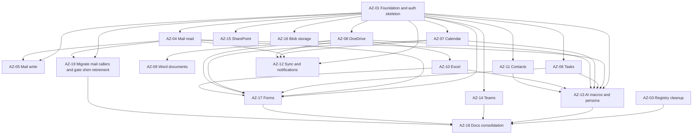

# reactory-azure — Implementation Plan

> **Companion to:** `docs/audit.md`
> **Status:** plan of record, revision 2. Revision 2 applies the 19 blocking and non-blocking
> findings from the 2026-11-08 QA review.
> **Intended executor:** AI engineering runs via `core.ProcessAITicket@1.4.7`, one ticket per
> worktree, reviewed by `QualityQuinn`.

---

## 1. How this plan is executed

Each numbered ticket below is delivered by one autonomous run: an isolated git worktree is
created from `origin/master` of **`git@github.com:reactorynet/reactory-azure.git`**, the
engineer implements and verifies, the reviewer independently re-runs the verification, and —
only if approved — a pull request is opened for human approval. The ticket moves to `resolved`
when the pull request is merged.

Three constraints shape the sequencing:

- **No server restarts.** Newly registered services and models do not exist in the running
  process until the owner restarts it. Every ticket verifies with unit tests against a mocked
  Graph layer. *No ticket may claim runtime or end-to-end verification it cannot perform.*
  Activation is an owner action, recorded in §6.
- **No Azure app registration exists in this environment.** Authentication is designed against
  the documented v2.0 endpoints and tested against a mocked token endpoint.
- **Merges require human sign-off.** A dependent ticket must not be dispatched until its
  dependency's PR is **merged** — a worktree is based on `origin/master` and will not otherwise
  contain the foundation.

### 1.1 Worktree and verification recipe

| Item | Value |
|---|---|
| Repository root for all module tickets | `/Users/wernerw/Projects/reactory/reactory-express-server/src/modules/reactory-azure` |
| Worktree created at | `<module repo>/../reactory-worktrees/ai-<flat ticket ref>`, i.e. `src/modules/reactory-worktrees/` |
| Test runner | `node /Users/wernerw/Projects/reactory/reactory-express-server/src/modules/reactory-reactor/scripts/ai/run-worktree-tests.js --module-root <worktree> <test paths>` |
| Exit contract | `0` = every suite loaded and every test passed; `1` = a load failure, an assertion failure, or the wrapper could not run |
| AZ-03 repository root | `/Users/wernerw/Projects/reactory/reactory-express-server` |
| AZ-19 repository root | `/Users/wernerw/Projects/reactory/reactory-express-server` |

`reactory-azure` is its own git repository. It has no `node_modules` and no jest config of its
own; the harness supplies both from the host server. Do **not** run a bare `npx jest`, and do
**not** add a second jest config.

`docs/audit.md` and `docs/implementation-plan.md` are currently **untracked** in the primary
checkout. A worktree created from `origin/master` therefore does **not** contain them. Every
ticket that needs to consult them must be given the content in its own description — which is
why each ticket below carries its own requirements in full.

### 1.2 Conventions every ticket must follow

- **Module identity stays `core.ReactoryAzure@1.0.0`.** Contributed components use the `azure`
  namespace: `azure.AzureMailService@1.0.0`. See audit §9.4 for why the module FQN is not
  changed. `package.json` `version` is set to `1.0.0` in AZ-01 so the package and the module FQN
  agree (audit D15).
- **Services** use the `@service({...})` decorator with `id`, `name`, `nameSpace: 'azure'`,
  `version`, `serviceType`, `lifeCycle: 'singleton'` and a `dependencies` array of
  `{ id, alias }`. Each file also exports `XServiceDefinition`. Follow
  `reactory-google/services/GmailService.ts` exactly.
- **File ownership is absolute.** AZ-01 creates every barrel, every service stub, every resolver
  stub, `routes/proxy.ts`, `routes/webhooks.ts`, `ai/index.ts` and `forms/index.ts`. **No ticket
  after AZ-01 may edit** `index.ts` (root), `services/index.ts`, `graphql/resolvers/index.ts`,
  `graphql/types/index.ts`, `routes/index.ts` or `middleware/index.ts`. A ticket that believes
  it must edit one of those stops and raises instead of doing it.
  **One declared exception:** `models/index.ts` is owned by AZ-01 and appended to by **AZ-12**,
  which is the only ticket that introduces models after the foundation. No other ticket may
  touch it.
- **Types** live in `types/*.ts`, are re-exported from `types/index.ts`, and every public
  service method has a named interface — no `Promise<any>`.
- **Errors** are thrown as `ApiError` (`@reactory/server-core/exceptions`) carrying the Graph
  error `code`. Never return `[]`, `null` or a truthy placeholder on failure.
- **Tests** live in `__tests__/<domain>.test.ts` and `__tests__/<domain>.request-shape.test.ts`.
- **`AGENT.md`** (singular — that is the tracked filename) must have its services table updated
  in the same ticket that changes a service.
- Import aliases: `@reactorynet/reactory-core`, `@reactory/server-core/*`.

### 1.3 New dependencies, introduced in AZ-01 only

```json
{
  "@microsoft/microsoft-graph-client": "^3.0.7",
  "@microsoft/microsoft-graph-types": "^2.40.0",
  "@azure/msal-node": "^2.16.2"
}
```
`@azure/msal-browser` is removed — a browser library in a server module (audit D10).
`@azure/storage-blob@12.23.0` and `@azure/storage-file-share@12.23.0` stay for AZ-16.
`@azure/identity` is added by AZ-16 only, for managed-identity auth to Blob Storage.

---

## 2. Dependency graph



**Independent of everything:** AZ-02 (docs only) and AZ-03 (different repository).
**Blocks everything:** AZ-01.

---

## 3. Ticket index

| # | Title | Type | Depends on | Size | Status |
|---|---|---|---|---|---|
| AZ-01 | Foundation: dependencies, types, Graph client provider, auth, token model, all stubs | feature | — | XL | **merged** |
| AZ-02 | Land audit and implementation plan in `docs/` | documentation | — | S | **delivered; committed by AZ-18** (the files were untracked) |
| AZ-03 | Registry metadata cleanup in `reactory-express-server` | chore | — | S | **merged** |
| AZ-04 | Mail: read, search, folders, categories | feature | AZ-01 | L | **merged** |
| AZ-05 | Mail: send, reply, forward, drafts, attachments | feature | AZ-01, AZ-04 | L | **merged** |
| AZ-06 | Tasks: Microsoft To Do | feature | AZ-01 | M | **merged** |
| AZ-07 | Calendar: events, calendars, availability, online meetings | feature | AZ-01 | L | **merged** |
| AZ-08 | OneDrive: files, folders, downloads, uploads, sharing | feature | AZ-01 | L | **merged** |
| AZ-09 | Documents: Word create, read, convert, replace | feature | AZ-08 | M | **merged** |
| AZ-10 | Excel workbooks: worksheets, ranges, tables | feature | AZ-08 | M | **merged** |
| AZ-11 | Contacts and organisation directory | feature | AZ-01 | M | **merged** |
| AZ-12 | Sync: delta state, change notifications, queues | feature | AZ-01, AZ-04, AZ-07, AZ-08 | L | **merged** |
| AZ-13 | AI macros and `AzureWorkspaceAssistant` persona | feature | AZ-01, AZ-04, AZ-06, AZ-07, AZ-08, AZ-10, AZ-11 | M | **merged** |
| AZ-14 | Teams: chats, channels, messages, presence | feature | AZ-01 | M | **merged** |
| AZ-15 | SharePoint: sites, lists, list items | feature | AZ-01 | M | **merged** |
| AZ-16 | Azure Blob Storage service | feature | AZ-01 | M | **merged** |
| AZ-17 | Forms and client surface | feature | AZ-01, AZ-04, AZ-06, AZ-07, AZ-08, AZ-10 | L | **merged** |
| AZ-18 | Documentation consolidation and module sign-off | documentation | AZ-03, AZ-13, AZ-14, AZ-17, AZ-19 | S | **this change — documentation only** |
| AZ-19 | Migrate the mail call sites and document the shim retirement gate | chore | AZ-01, AZ-04 | M | **merged** |

**How these statuses were established.** A ticket is marked **merged** only when its deliverable
is present in the module source on `master` *and* exercised by a suite under `__tests__/` —
verified by reading the code for this consolidation, not copied from an issue tracker. Two entries
deserve a plain statement:

- **AZ-02** produced `docs/audit.md` and `docs/implementation-plan.md`, but `docs/` was never
  added to git (it was untracked in the working tree). AZ-18 commits both files, so the plan is
  now version-controlled rather than folklore.
- **AZ-18** is documentation only. It closes the *documentation* gap; it does **not** satisfy §5,
  which is a human sign-off gate evaluated after all nineteen tickets merge. Closing AZ-18 does
  not mean the module is done.

**Runtime activation is a separate step for every ticket above.** Merged code is inert until the
express server restarts — see `docs/operations.md` §7.

### 3.1 Delivery waves

```
Wave 0 (parallel, no shared files):
  AZ-01  azure repo, code and stubs
  AZ-02  azure repo, docs/ only          -- must NOT touch README.md (AZ-01 owns it)
  AZ-03  express-server repo, registry JSON only

Wave 1a (parallel, requires AZ-01 MERGED):
  AZ-04, AZ-06, AZ-07, AZ-08, AZ-11, AZ-14, AZ-15, AZ-16
  (AZ-04 was omitted from this list in revision 4 -- a defect: it depends only on
   AZ-01, and it is the headline "retrieve emails" capability. Corrected 2026-11-08.)

Wave 1b (requires AZ-01 + AZ-04 merged):
  AZ-05

Wave 1c (requires AZ-08 merged):
  AZ-09, AZ-10

Wave 2 (requires its listed dependencies merged):
  AZ-12, AZ-13, AZ-17, AZ-19

Wave 3:
  AZ-18
```

**Realistic output for one morning with the owner away:** one foundation PR, one registry PR,
one docs PR. Nothing else can be *dispatched* until AZ-01 is merged, and nothing is *active*
until the owner restarts the server. `resolved` means merged, not working.

File-conflict note: AZ-01 and AZ-02 both live in the azure repo. AZ-01 owns `README.md`;
AZ-02 must not edit it. AZ-02 therefore only adds `docs/audit.md` and `docs/implementation-plan.md`.

---

## 4. Ticket specifications

### AZ-01 — Foundation: dependencies, types, Graph client provider, auth, token model, all stubs

**Goal.** Replace the non-executing stub with a walking skeleton that *compiles and registers*:
the module exposes real services and models, the Graph client can actually be constructed, one
query (`azureConnectionStatus`) proves the chain from resolver to service to token store, and
every later ticket has a pre-created file to fill in without touching a shared barrel.

**Create**

```
package.json                    (rewrite: deps from §1.3, version 1.0.0, main index.ts.
                                 Do NOT add a jest config — the host harness supplies it)
tsconfig.json                   (include ./**/*.ts, extends ../../tsconfig.json)
index.ts                        (rewrite: full contribution wiring; see requirement 8)
types/index.ts
types/azure.types.ts            (AzureConnectionStatus enum, IAzureConnection, IAzureConfig)
types/graph.types.ts            (IGraphRequestOptions, IGraphPage<T>, IBatchRequest, IBatchResponse)
types/mail.types.ts             (stub: header + TODO(AZ-04))
types/tasks.types.ts            (stub)
types/calendar.types.ts         (stub)
types/drive.types.ts            (stub)
types/document.types.ts         (stub)
types/workbook.types.ts         (stub)
types/contacts.types.ts         (stub)
types/teams.types.ts            (stub)
types/sharepoint.types.ts       (stub)
types/storage.types.ts          (stub)
utils/index.ts
utils/token-encryption.ts       (AES-256-GCM: encryptToken, decryptToken, generateEncryptionSalt)
utils/scopes.ts                 (per-service scope registry, getScopesForServices, getDefaultScopes)
utils/cache-keys.ts             (azure:{userId}:{domain}:{key})
utils/graph-error.ts            (Graph error body -> ApiError, preserving the Graph `code`)
utils/odata.ts                  (buildQuery for select/filter/search/orderby/top/expand + header helpers)
services/graph/AzureGraphClientProvider.ts   (the ONLY path for this class)
services/index.ts               (barrel: imports and lists ALL 16 definitions)
services/AzureAuditService.ts               (implemented)
services/AzureAuthService.ts                (implemented)
services/AzureService.ts                    (implemented: facade over all 16)
services/AzureMailService.ts                (stub, FQN azure.AzureMailService@1.0.0)
services/AzureTodoService.ts                (stub)
services/AzureCalendarService.ts            (stub)
services/AzureDriveService.ts               (stub)
services/AzureDocumentService.ts            (stub)
services/AzureWorkbookService.ts            (stub)
services/AzureContactsService.ts            (stub)
services/AzureSyncService.ts                (stub)
services/AzureSubscriptionService.ts        (stub)
services/AzureTeamsService.ts               (stub)
services/AzureSharePointService.ts          (stub)
services/AzureBlobStorageService.ts         (stub)
services/graph.ts               (REWRITE as a deprecated compatibility shim — see requirement 10)
models/index.ts                 (barrel: AzureToken, AzureAuditLog. Later models are appended
                                 by the one ticket that owns them; no other ticket adds a model)
models/AzureToken.ts
models/AzureAuditLog.ts
graphql/index.ts
graphql/types/index.ts          (loads every .graphql file, including the stub types below)
graphql/types/Auth.graphql
graphql/types/Mail.graphql      (stub type Query { _azureMailPlaceholder: Boolean })
graphql/types/Tasks.graphql     (stub)
graphql/types/Calendar.graphql  (stub)
graphql/types/Drive.graphql     (stub)
graphql/types/Documents.graphql (stub)
graphql/types/Workbook.graphql  (stub)
graphql/types/Contacts.graphql  (stub)
graphql/types/Teams.graphql     (stub)
graphql/types/SharePoint.graphql(stub)
graphql/resolvers/index.ts      (barrel: lists every resolver below)
graphql/resolvers/AuthResolver.ts        (implemented)
graphql/resolvers/MailResolver.ts        (stub resolver, throws not-implemented)
graphql/resolvers/TasksResolver.ts       (stub)
graphql/resolvers/CalendarResolver.ts    (stub)
graphql/resolvers/DriveResolver.ts       (stub)
graphql/resolvers/DocumentsResolver.ts   (stub)
graphql/resolvers/WorkbookResolver.ts    (stub)
graphql/resolvers/ContactsResolver.ts    (stub)
graphql/resolvers/TeamsResolver.ts       (stub)
graphql/resolvers/SharePointResolver.ts  (stub)
graphql/types/Sync.graphql      (stub)
graphql/resolvers/SyncResolver.ts        (stub)
routes/index.ts                 (mounts auth, webhooks, proxy routers below)
routes/auth.ts                  (implemented)
routes/webhooks.ts              (empty router; real handlers added by AZ-12)
routes/proxy.ts                 (empty router; real handlers added by AZ-08)
middleware/webhook-verification.ts  (stub: exports an empty middleware array)
middleware/index.ts             (exports the array from webhook-verification)
ai/index.ts                     (re-exports AZURE_MACROS and AZURE_TOOLS)
ai/macros/index.ts              (assembles AZURE_MACROS from the per-domain arrays below;
                                 owned by AZ-01, edited by NO later ticket)
ai/macros/status.macros.ts      (stub: export const STATUS_MACROS = [])
ai/macros/mail.macros.ts        (stub: export const MAIL_MACROS = [])
ai/macros/calendar.macros.ts    (stub: export const CALENDAR_MACROS = [])
ai/macros/drive.macros.ts       (stub: export const DRIVE_MACROS = [])
ai/macros/workbook.macros.ts    (stub: export const WORKBOOK_MACROS = [])
ai/macros/contacts.macros.ts    (stub: export const CONTACTS_MACROS = [])
ai/macros/tasks.macros.ts       (stub: export const TASKS_MACROS = [])
ai/macros/teams.macros.ts       (stub: export const TEAMS_MACROS = [])
forms/index.ts                  (exports [] — AZ-17 fills it)
queues/index.ts                 (exports [] — AZ-12 fills it)
__tests__/utils.test.ts
__tests__/graph-provider.test.ts
__tests__/auth-service.test.ts
__tests__/contract-shape.test.ts
AGENT.md                        (rewrite for the new architecture)
README.md                       (rewrite: no longer "example only")
```

The stub service files must export the **final** symbol and FQN, for example:

```ts
@service({ id: 'azure.AzureMailService@1.0.0', name: 'AzureMailService', nameSpace: 'azure',
           version: '1.0.0', serviceType: 'data', lifeCycle: 'singleton', dependencies: [] })
export class AzureMailService implements Reactory.Service.IReactoryService {
  async listMessages(): Promise<never> {
    throw new ApiError('not implemented', { ticket: 'AZ-04' });
  }
}
export const AzureMailServiceDefinition = { /* same id, service factory */ };
```

**Requirements**

1. `AzureGraphClientProvider` uses `Client.init({ authProvider })` where `authProvider` calls
   `AzureAuthService.getToken(userId)`. **`Client` and `ResponseType` must be imported.**
   `debugLogging: false`. `services/graph/AzureGraphClientProvider.ts` is the only location for
   this class.
2. `request<T>()`, `requestAll<T>()`, `delta<T>()`, `batch()` per audit §9.3. `requestAll`
   follows `@odata.nextLink` up to a `maxPages` bound and throws when the bound is hit rather
   than silently truncating. `batch` refuses more than 20 requests.
3. Retry: `429`/`503` honour `Retry-After`; `5xx` exponential backoff with jitter, 3 attempts;
   never retry other `4xx`. Every failure becomes `ApiError` with the Graph `code` preserved.
4. `AzureAuthService`: `getAuthorizationUrl`, `handleAuthCallback`, `refreshAccessToken`,
   `getToken`, `hasValidToken`, `getGrantedScopes`, `getConnectionStatus`, `revokeAccess`,
   `getAuthorizedClient`, `getUserDetails`. PKCE via `msal.CryptoProvider.generatePkceCodes()`;
   `state` in Redis with 600 s TTL; tokens AES-256-GCM encrypted with a per-user salt.
4a. `getUserDetails(userId, options?: { profileImage?: boolean; imageSize?: string })` returns
   `{ firstName, lastName, email, avatar }` from `/me`, with the photo only when requested. It
   exists because the legacy shim exposes `getUserDetails` and a consumer depends on it.
4b. **Legacy token bridge.** `getToken(userId)` returns
   `{ token: string; source: 'vault' | 'legacy' }` and falls back to the user document's
   `getAuthentication('microsoft').props.accessToken`, read through `core.UserService@1.0.0`,
   when no `AzureToken` record exists. The fallback never writes to `AzureToken`. Four
   constraints apply, each of which exists to stop it failing open:

   - **Never cached.** A legacy token carries no `scope` and no `expires` in
     `authentications[].props`, so any TTL would be a guess and a revoked token would keep
     being served. Legacy-sourced tokens bypass Redis entirely; only `vault`-sourced tokens
     are cached, to expiry - 60 s.
   - **No refresh.** `isTokenValid` is a closure inside `ProfileResolver.ts` and is not
     exported; only that profile flow refreshes. When a request made with a `legacy` token
     returns `401`, `AzureGraphClientProvider` must raise
     `ApiError('LegacyTokenExpired')` - a distinct code, not
     `InvalidAuthenticationToken` - so callers prompt a reconnect instead of treating it as a
     revoked grant.
   - **Unknown scopes.** `getGrantedScopes(userId)` returns `['legacy:unverified']` when the
     source is legacy, because the granted scope string does not exist on the user document.
     Scope gates must read that value as *attempt the call and surface the real Graph error*,
     never as *insufficient scope*, or every legacy user is locked out.
   - **No leaks.** The token is never logged, and `AzureAuditService` redaction additionally
     covers the keys `token` and `bearer` alongside `authorization`, `access_token` and
     `refresh_token`.
5. `AzureToken` model: `userId` (unique), `accessTokenEncrypted`, `refreshTokenEncrypted`,
   `accessTokenExpiry`, `grantedScopes[]`, `azureUserId` (oid), `tenantId` (tid), `upn`,
   `encryptionSalt`, `connectedAt`, `lastRefreshedAt?`, `revokedAt?`. Collection `azure_tokens`.
6. `AzureAuditLog` model: `userId`, `operation`, `resource`, `outcome`, `durationMs`,
   `graphCode?`, `correlationId?`, `metadata?`. Collection `azure_audit_logs`.
   `AzureAuditService.logOperation(...)` redacts `authorization`, `access_token` and
   `refresh_token` keys and never throws.
7. `AzureService` facade exposes one getter per service, including the stubs, plus
   `getConnectionStatus` and `disconnectAccount`.
8. `index.ts` wires `graphDefinitions: GraphqlDefinitions` (imported from `./graphql`, exactly
   as `reactory-google/index.ts:20` does), `services`, `models`, `forms`, `queues`,
   `routes: { '/azure': routes }`, `middleware`, `ai` and
   `reactor: { providers: [], agents: [], macros: AZURE_MACROS, tools: AZURE_TOOLS, mcp: [] }`.
   Declare `translations`, `clientPlugins`, `pdfs`, `passportProviders` and `grpc` as the
   current file already does.
9. `graphql/types/Auth.graphql` + `AuthResolver`: `azureConnectionStatus` query,
   `azureAuthUrl(services: [String!])` mutation, `azureDisconnect` mutation.
10. **`services/graph.ts` is rewritten, not deleted.** It has three live importers in
    `reactory-core` — `resolvers/Emails/UserEmails.ts:9,22`,
    `resolvers/User/ProfileResolver.ts:6,223,254` and `services/EmailService.ts:9` — in a
    repository this ticket does not operate in. Preserve the default export `MSGraph` and all
    nine method names, delegate each to the new provider or `AzureService`, mark the file
    `@deprecated` with a comment naming AZ-19 as the removal ticket, and fix the fail-open
    `sendEmail` (audit D6) so it rejects. `types.d.ts` may be deleted **only** once the shim no
    longer references `Reactory.MicrosoftGraph.Service.IMicrosoftGraph`; if it still does, keep
    the interface and add `getEmails` to it (audit D3).
11. `AGENT.md`: module purpose, the services table with all 16 FQNs and the ticket that delivers
    each, Graph coverage, environment variables (`AZURE_CLIENT_ID`, `AZURE_CLIENT_SECRET`,
    `AZURE_TENANT_ID`, `AZURE_REDIRECT_URI`, `AZURE_TOKEN_ENCRYPTION_KEY`,
    `AZURE_API_RATE_LIMIT`), and the test recipe from §1.1.

**Acceptance criteria**

- `services/index.ts` exports **exactly 16** definitions, all with `azure.*@1.0.0` FQNs,
  enumerated in the test.
- A test asserts the provider is constructed with a `Client` from the SDK and that
  `debugLogging` is `false`.
- A test asserts a `401` from a mocked Graph call rejects with `ApiError` and
  `code: 'InvalidAuthenticationToken'` — it does not return `[]` or `null`.
- A test asserts the shim's `sendEmail` rejects on a Graph failure and never resolves to an
  object. A test asserts the shim exports the same nine method names as before.
- A test asserts `requestAll` follows three `@odata.nextLink` pages and returns all items, and
  that exceeding `maxPages` throws.
- A test asserts a `429` with `Retry-After: 2` is retried exactly once (fake timers).
- A test asserts `encryptToken`/`decryptToken` round-trip and that a tampered ciphertext throws.
- A test asserts `getAuthorizationUrl` contains `code_challenge_method=S256`,
  `response_type=code`, `offline_access` and a `state` present in the fake Redis.
- `grep -rn "services/AzureGraphClientProvider"` finds nothing (single canonical path).
- `AGENT.md` service rows equal the exported definition count.

**Out of scope.** Any Graph domain implementation. Any live tenant call. `types.d.ts` deletion
if the shim still needs it.

---

### AZ-02 — Land audit and implementation plan in `docs/`

**Goal.** The two documents that justify and sequence this rebuild live in the repository.

**Files.** `docs/audit.md`, `docs/implementation-plan.md`. **Do not edit `README.md`** — AZ-01
owns it.

**Requirements.** Reproduce the audit and plan **exactly as supplied in this ticket's
description**, which are revision 2 and already include every correction from the 2026-11-08 QA
review. Do not re-derive them, do not "improve" them, and do not reintroduce the superseded
claims — the interface method count, the documentation filename, the TS1016 attribution and the SharePoint expansion parameter. The corrected values are in the supplied content; do not substitute the superseded ones.
Preserve the mermaid diagram — **node labels must not contain parentheses**.

**Acceptance criteria.** Both files exist and render. `grep -c "^## " docs/audit.md` returns 12.
`grep -c "^## " docs/implementation-plan.md` returns 7. The ticket index has 19 rows and every
ID in the index has a matching `### AZ-` specification section. The superseded claims do not
reappear as assertions:

```bash
# 1. the singular documentation filename is used everywhere, with no plural spelling
[ "$(grep -rl 'AGENT[S]' docs/ | wc -l)" -eq 0 ]
# 2. the corrected TS1016 attribution is not reintroduced
[ "$(grep -rl 'd[.]ts:22' docs/ | wc -l)" -eq 0 ]
# 3. AZ-15 mandates the non-dollar form; the audit names the dollar form once, as a finding
[ "$(grep -c '[$]expand=fields' docs/audit.md)" -eq 1 ]
[ "$(grep -c '[$]expand=fields' docs/implementation-plan.md)" -eq 0 ]
```

Each pattern is written with a bracket expression so it does **not** match its own literal text
in this block. The single audit occurrence is the G3a heading that *documents* the distinction;
deleting it would delete the finding.

**Out of scope.** Any code change. Any edit to `README.md`.

---

### AZ-03 — Registry metadata cleanup in `reactory-express-server`

**Goal.** The module is MIT and community-oriented, but `available.json` still carries a shop
URL selling it.

**Repository.** `reactory-express-server` (different repo — worktree from that root).

**Files.** `src/modules/available.json`, `src/modules/enabled-reactory.json`,
`src/modules/installed.json`.

**Requirements.** Remove the `shop` key for `reactory-azure` only. Confirm `license` is `MIT` in
all three. Do not touch any other module entry. Do not regenerate `__index.ts`. Do not restart.

**Acceptance criteria.** This exact assertion passes for each of the three files:

```bash
node -e "const a=require('./src/modules/available.json');const m=a.find(x=>x.id==='reactory-azure');if(!m)throw new Error('missing');if(m.shop)throw new Error('shop still present');if(m.license!=='MIT')throw new Error('license '+m.license);console.log('ok')"
```
Substitute `enabled-reactory.json` and `installed.json` for the other two.

**Out of scope.** The module repository; `__index.ts`; `reactory-docs` regeneration.

---

### AZ-04 — Mail: read, search, folders, categories

**Goal.** "Retrieve emails" — the headline requirement — works properly: paged, searchable,
filterable, with a real error contract.

**Files.** `types/mail.types.ts`, `services/AzureMailService.ts`,
`graphql/types/Mail.graphql`, `graphql/resolvers/MailResolver.ts`,
`__tests__/mail-service.test.ts`, `__tests__/mail.request-shape.test.ts`, `AGENT.md`.

**Requirements**

1. `listMessages(userId, options)` — `/me/messages` with `$select`, `$filter`, `$search`,
   `$top`, `$orderby`; returns `{ items, nextLink }`, or uses `requestAll` when
   `options.all === true`.
2. `getMessage(userId, id, options)` — optional `$expand=attachments`; typed `IMailMessage`
   with `body` normalised to `{ contentType, content }` and recipients as
   `{ name, address }[]`.
3. `listFolders(userId)` — `/me/mailFolders`, cached 10 min in Redis, including
   `childFolderCount` and `unreadItemCount`.
4. `listMessagesInFolder(userId, folderId, options)`.
5. `listCategories(userId)` / `setCategories(userId, messageId, categories)` —
   `/me/outlook/masterCategories` and `PATCH /me/messages/{id}`.
6. `listByConversation(userId, conversationId, options)` — **named for what Graph supports.**
   Do not expose a `getThread` implying Gmail thread semantics.
7. Search contract, stated in JSDoc: `$search` is not Gmail query syntax; it requires
   `ConsistencyLevel: eventual`; it behaves differently per resource. **Verify** whether
   `$search` may be combined with `$orderby`/`$count` and record the finding — do not assert it.
   Until verified, when `search` is supplied and the caller did not explicitly set `orderBy`,
   send no `$orderby` and no `$count`.
8. Optional `Prefer: IdType="ImmutableId"`, with JSDoc noting that ids change shape as a result.
9. GraphQL: `azureMailMessages`, `azureMailMessage`, `azureMailFolders`, `azureMailCategories`,
   `azureMailConversation` queries; `azureSetMailCategories` mutation.

**Acceptance criteria.** Request-shape tests assert the exact `path`, `select`, `filter`,
`search`, `top` and `Prefer` header. A test asserts a four-page `nextLink` chain returns every
item in order. A test asserts `$search` alone produces no `$orderby` and no `$count`. A test
asserts a `400 ErrorInvalidRequest` surfaces as `ApiError` with that code. No method returns
`[]` on error.

**Out of scope.** Send, reply, drafts, attachments (AZ-05). Delta (AZ-12).

---

### AZ-05 — Mail: send, reply, forward, drafts, attachments

**Goal.** Outbound mail that **fails loudly** — the direct repair of audit D6.

**Files.** `services/AzureMailService.ts` (extend AZ-04's file), `types/mail.types.ts` (extend),
`graphql/types/Mail.graphql`, `graphql/resolvers/MailResolver.ts`,
`__tests__/mail-write.test.ts`, `__tests__/mail-write.request-shape.test.ts`, `AGENT.md`.

**Requirements**

1. `sendMessage(userId, input)` — `POST /me/sendMail` with `message` and `saveToSentItems`.
   Accepts `to`, `cc`, `bcc`, `subject`, `body: { contentType: 'Text' | 'HTML', content }`,
   `attachments`, `importance`.
2. `replyToMessage`, `replyAll`, `forwardMessage` — `/messages/{id}/reply|replyAll|forward` with
   an optional comment. Do not hand-roll quoting.
3. Drafts: create with `POST /me/messages` (**do not** set `isDraft: true`); update with
   `PATCH /me/messages/{id}`; send with `POST /me/messages/{id}/send`; delete with
   `DELETE /me/messages/{id}`.
4. `listAttachments(userId, messageId)` returning metadata only.
5. `getAttachment(userId, messageId, attachmentId)` returning
   `{ name, contentType, size, contentBytes }`.
6. Attachments above the documented simple-upload limit use `createUploadSession` and stream.
   `sendMessage` must reject rather than silently drop an attachment it cannot send.
7. GraphQL mutations: `azureSendMail`, `azureReplyMail`, `azureForwardMail`,
   `azureCreateMailDraft`, `azureSendMailDraft`, `azureDeleteMailDraft`.

**Acceptance criteria.** A test asserts a Graph failure in `sendMessage` **rejects with
`ApiError`** and that no code path can resolve to a `response` module export. A test asserts the
send body shape exactly, including `saveToSentItems`. A test asserts a 3 MB attachment takes the
upload-session path and a 100 KB attachment takes the inline path. A test asserts reply/forward
target the correct sub-path and carry no locally-generated quoting.

**Out of scope.** Reading mail (AZ-04). Storing attachments in a Reactory file service.

---

### AZ-06 — Tasks: Microsoft To Do

**Goal.** Real task retrieval and management on the GA surface, replacing the retired
`outlook/tasks` endpoint.

**Files.** `types/tasks.types.ts`, `services/AzureTodoService.ts`,
`graphql/types/Tasks.graphql`, `graphql/resolvers/TasksResolver.ts`,
`__tests__/todo-service.test.ts`, `__tests__/todo.request-shape.test.ts`, `AGENT.md`.

**Requirements**

1. Task lists: `listTaskLists`, `getTaskList`, `createTaskList`, `updateTaskList`,
   `deleteTaskList` over `/me/todo/lists`.
2. Tasks: `listTasks(userId, listId, options)`, `getTask`, `createTask`, `updateTask`,
   `deleteTask`, `completeTask`.
3. Model the real To Do shape: `title`, `body`, `importance`, `status`
   (`notStarted|inProgress|completed|waitingOnOthers|deferred`), `dueDateTime`, `startDateTime`,
   `reminderDateTime`, `isReminderOn`, `recurrence`, `categories`, `checklistItems`,
   `linkedResources`, `completedDateTime`.
4. Checklist items under `/me/todo/lists/{listId}/tasks/{taskId}/checklistItems` — full CRUD.
5. **No `assignedTo`.** To Do tasks have no assignee; assignment is a Planner concern
   (`/planner/tasks` + `assignments`). State this in the class JSDoc, in `AGENT.md` and in the
   GraphQL type description. Do not accept an `assignedTo` argument and silently ignore it.
6. **`beta` is not used anywhere in this file.** `grep` for it in the module must return nothing
   outside the shim's documented legacy block.
7. **Verify** the supported `$filter` properties against the To Do reference before
   implementing. If `dueDateTime` is unsupported, filter client-side and say so in JSDoc.
8. GraphQL: `azureTodoLists`, `azureTodoTasks`, `azureTodoTask` queries; create/update/
   complete/delete mutations.

**Acceptance criteria.** Request-shape tests assert the exact paths for all five list operations
and all seven task operations. A test asserts `createTask` sends `recurrence` and
`checklistItems` unchanged. A test asserts an invalid `status` is rejected client-side with a
clear message rather than being sent to Graph. A test asserts no request path contains
`outlook/tasks`.

**Out of scope.** Planner. Sharing lists.

---

### AZ-07 — Calendar: events, calendars, availability, online meetings

**Files.** `types/calendar.types.ts`, `services/AzureCalendarService.ts`,
`graphql/types/Calendar.graphql`, `graphql/resolvers/CalendarResolver.ts`,
`__tests__/calendar-service.test.ts`, `__tests__/calendar.request-shape.test.ts`, `AGENT.md`.

**Requirements**

1. Calendars: `listCalendars` (cached 5 min), `getCalendar`, `listCalendarEvents`.
2. Events: `listEvents(userId, options)`; `listCalendarView(userId, start, end)` using
   `/me/calendarView` — **`calendarView` is the correct endpoint for a date window**, because
   `/events` does not expand recurrences. Prefer `calendarView` for any ranged query.
3. `getEvent`, `createEvent`, `updateEvent`, `deleteEvent`, `cancelEvent` (with comment),
   `acceptEvent`, `declineEvent`, `tentativelyAcceptEvent`.
4. Availability: `getSchedule(userId, schedules[], start, end, interval)` over
   `POST /me/calendar/getSchedule`; `findMeetingTimes(...)` over `POST /me/findMeetingTimes`.
   Both are Graph capabilities with no Google-module equivalent — surface them as first-class
   queries.
5. Online meetings: `isOnlineMeeting`, `onlineMeetingProvider: 'teamsForBusiness'` on create;
   read `onlineMeeting.joinUrl`. Never synthesise a join link.
6. Recurrence: expose the Graph `patternedRecurrence` shape as its own type. Do not model it
   after Google's `recurrence: string[]`.
7. Time zones: every date carries `{ dateTime, timeZone }`. Never send a bare ISO string where
   Graph expects a `dateTimeTimeZone`.
8. GraphQL: `azureCalendars`, `azureCalendarEvents`, `azureCalendarView`, `azureCalendarEvent`,
   `azureCalendarSchedule`, `azureFindMeetingTimes` queries; create/update/delete/respond/cancel
   mutations.

**Acceptance criteria.** A test asserts a ranged list uses `/me/calendarView` and not
`/me/events`. A test asserts `getSchedule` sends the documented body including
`availabilityViewInterval`. A test asserts a recurring master event returns `recurrence` intact.
A test asserts `isOnlineMeeting: true` sends `onlineMeetingProvider: 'teamsForBusiness'`. A test
asserts a `dateTimeTimeZone` is never serialised as a bare string.

**Out of scope.** Room/resource booking via Places. Calendar sharing ACLs.

---

### AZ-08 — OneDrive: files, folders, downloads, uploads, sharing

**Files.** `types/drive.types.ts`, `services/AzureDriveService.ts`,
`graphql/types/Drive.graphql`, `graphql/resolvers/DriveResolver.ts`, `routes/proxy.ts` (extend
AZ-01's file), `__tests__/drive-service.test.ts`, `__tests__/drive.request-shape.test.ts`,
`AGENT.md`.

**Requirements**

1. `getDefaultDrive(userId)` — `/me/drive`; `listDrives(userId)` — `/drives`.
2. `listChildren(userId, itemId?)` — `/me/drive/root/children` or `/items/{id}/children`, paged.
3. `getItem`, `getItemByPath` — `/me/drive/root:/{path}`. **URL-encode every path segment**; a
   filename containing `#`, `?` or a space must not change the request path.
4. `search(userId, query)` — `/me/drive/root/search(q='{query}')`, query encoded.
5. `downloadItem(userId, itemId)` — `GET /items/{id}/content`, following the 302 to the
   pre-authenticated URL **without forwarding the `Authorization` header** to the storage host.
   Return a stream.
6. `uploadItem(...)` — simple upload up to the documented limit, `createUploadSession` above it,
   with resumable chunking.
7. `createFolder`, `moveItem`, `copyItem` (async monitor), `deleteItem`, `restoreItem`.
8. `createShareLink`, `inviteCollaborators`, `listPermissions`, `deletePermission`.
9. `listVersions`, `restoreVersion`, `getThumbnail`.
10. Route handlers in `routes/proxy.ts`: `GET /azure/files/:itemId` and
    `GET /azure/files/:itemId/thumbnail`, proxying the stream with a content type and
    `Content-Disposition`. Never expose the pre-authenticated URL to the client.
11. GraphQL: `azureDrive`, `azureDriveItems`, `azureDriveItem`, `azureDriveSearch`,
    `azureDrivePermissions`, `azureDriveVersions` queries; create/upload/move/copy/delete/share
    mutations.

**Acceptance criteria.** A test asserts a path containing `a b#c?.txt` is percent-encoded. A
test asserts `downloadItem` follows a redirect **and drops the Authorization header** on the
redirected request. A test asserts a small upload uses `PUT .../content` and a large upload uses
`createUploadSession` with the documented chunk size. A test asserts a 404 `itemNotFound`
surfaces as `ApiError`.

**Out of scope.** Word/Excel semantics (AZ-09, AZ-10). Cross-tenant guest sharing.

---

### AZ-09 — Documents: Word create, read, convert, replace

**Goal.** The document capability Azure *can* deliver — and an explicit refusal to promise the
one it cannot.

**Files.** `types/document.types.ts`, `services/AzureDocumentService.ts`,
`graphql/types/Documents.graphql`, `graphql/resolvers/DocumentsResolver.ts`,
`__tests__/document-service.test.ts`, `AGENT.md`.

**Requirements**

1. `createFromTemplate(userId, templateItemId, name, replacements)` — copy the template and apply
   token replacement. Document honestly that this is text substitution, **not** structural
   editing.
2. `getDocumentText(userId, itemId)` — download and extract text. State the library and its
   fidelity limits (headers, footnotes, text boxes may be lost).
3. `convertToPdf(userId, itemId)` — `GET /items/{id}/content?format=pdf`.
   **The conversion endpoint is capped at 2 MB per file** and supports only documented format
   pairs. Read `size` from `getDocumentMetadata` first; above 2 MB, reject with a typed
   `ApiError('FileTooLargeForConversion', { size, limit: 2 * 1024 * 1024 })` naming the limit and
   issue **no request**. Never return a truncated or empty stream.
4. `replaceDocument(userId, itemId, content)` — upload a replacement `.docx`.
5. `getDocumentMetadata(userId, itemId)` — size, `lastModifiedBy`, `createdDateTime`, `webUrl`.
6. **Do not implement `batchUpdate`.** Add a class-level JSDoc block quoting audit §7 G1: there
   is no server-side Word body-editing API; the Office JS API requires an Office Add-in running
   in the document. List the three extraction alternatives — server-side `.docx` parser, Office
   Add-in, or the **beta** `documentProcessingJob` pipeline — and their costs.
7. GraphQL: `azureDocumentText`, `azureDocumentMetadata`, `azureDocumentPdf` queries;
   `azureCreateDocumentFromTemplate`, `azureReplaceDocument` mutations.

**Acceptance criteria.** A test asserts `convertToPdf` requests `?format=pdf` for a document
under 2 MB and returns a stream. A test asserts a >2 MB document throws
`FileTooLargeForConversion` and makes **no** request. A test asserts `getDocumentText` throws a
clear `ApiError` for a non-`.docx` item rather than returning binary. The class JSDoc contains
the phrase "no server-side Word body-editing API" — a reviewer greps for it. No method is named
`batchUpdate`.

**Out of scope.** Rich-text editing. Document comments (a beta-only capability, not an absence).
Track changes. Co-authoring.

---

### AZ-10 — Excel workbooks: worksheets, ranges, tables

**Files.** `types/workbook.types.ts`, `services/AzureWorkbookService.ts`,
`graphql/types/Workbook.graphql`, `graphql/resolvers/WorkbookResolver.ts`,
`__tests__/workbook-service.test.ts`, `__tests__/workbook.request-shape.test.ts`, `AGENT.md`.

**Requirements**

1. `listWorksheets(userId, itemId)` — `/workbook/worksheets`, cached 2 min.
2. `getUsedRange(...)` — `.../usedRange` with optional `valuesOnly`.
3. `getRange(...)` — `.../range(address='A1:D20')`.
4. `updateRange(...)` — `PATCH .../range` with `{ values, formulas?, numberFormat? }`.
5. `appendRows`, `clearRange`.
6. Tables: `listTables`, `getTable`, `addTableRow`, `deleteTableRow`, `listTableColumns`.
7. `createSession` / `closeSession` — `/workbook/createSession` with `persistChanges: true`.
   Session ids must be sent on every subsequent request **and closed in a `finally`**; a leaked
   session pins the workbook.
8. Values are `any[][]`. Document that Graph returns `null` for empty cells and `#VALUE!`-style
   strings for error cells, and do not coerce them.
9. GraphQL: `azureWorkbookWorksheets`, `azureWorkbookRange`, `azureWorkbookTables` queries;
   `azureUpdateWorkbookRange`, `azureAppendWorkbookRows` mutations.

**Acceptance criteria.** Request-shape tests assert every documented workbook path. A test
asserts a session is closed even when the operation throws. A test asserts `#DIV/0!` and `null`
cells survive the round trip unchanged. A test asserts a large `values` payload is not silently
truncated.

**Out of scope.** Charts, pivot tables, conditional formatting.

---

### AZ-11 — Contacts and organisation directory

**Files.** `types/contacts.types.ts`, `services/AzureContactsService.ts`,
`graphql/types/Contacts.graphql`, `graphql/resolvers/ContactsResolver.ts`,
`__tests__/contacts-service.test.ts`, `AGENT.md`.

**Requirements**

1. `listContacts(userId, options)` — `/me/contacts`, paged, selecting
   `displayName,emailAddresses,businessPhones,mobilePhone,companyName,jobTitle`.
2. `getContact`, `createContact`, `updateContact`, `deleteContact`.
3. `listContactFolders`, `listContactsInFolder`.
4. `searchPeople(userId, query)` — `/me/people?$search=`. **`$skip` is not supported with
   `$search`**, so paging must use `@odata.nextLink` only.
5. `listDirectoryUsers(userId, options)` — `/users` with `$select`/`$filter`; requires
   `User.ReadBasic.All` or `User.Read.All`. Document the permission difference.
6. `getContactPhoto(userId, contactId)` — `/me/contacts/{id}/photo/$value` returning a data URI
   with the response's content type. Return `null` **only** on a documented `ImageNotFound`;
   every other failure throws.
7. GraphQL: `azureContacts`, `azureContact`, `azureContactFolders`, `azurePeople`,
   `azureDirectoryUsers` queries; create/update/delete mutations.

**Acceptance criteria.** A test asserts `listContacts` pages correctly. A test asserts
`searchPeople` uses `$search` and not an OData `$filter` on `displayName`, and sends no `$skip`.
A test asserts `getContactPhoto` returns `null` on `ImageNotFound` and **throws** on `401`. A
test asserts `listDirectoryUsers` throws a clear "insufficient scope" `ApiError` when
`getGrantedScopes(userId)` returns a non-empty list containing no `User.Read*` scope, and that
the exact value `['legacy:unverified']` **does not** trigger that gate - it attempts the call.
Scope checks read the stored `grantedScopes[]` from a fake `AzureToken` record - no network
and no tenant are involved.

**Out of scope.** Writing the org directory. Guest invites.

---

### AZ-12 — Sync: delta state, change notifications, queues

**Goal.** Make the module event-driven rather than polled, and repeated reads cheap.

**Files.** `models/AzureSyncState.ts`, `models/AzureSubscription.ts`, `models/index.ts` (append
these two — this is the only ticket that may edit this barrel after AZ-01),
`services/AzureSyncService.ts`, `services/AzureSubscriptionService.ts`, `queues/index.ts`,
`queues/*.ts`, `routes/webhooks.ts` (extend AZ-01's file),
`middleware/webhook-verification.ts` (extend AZ-01's stub), `graphql/types/Sync.graphql`,
`graphql/resolvers/SyncResolver.ts`, `__tests__/sync-service.test.ts`,
`__tests__/subscription-service.test.ts`, `__tests__/webhook.test.ts`, `AGENT.md`.

**Requirements**

1. `AzureSyncState`: `userId`, `resource` (`messages|events|drive`), `deltaLink`,
   `lastSyncedAt`, `cursor?`, `status`. Unique on `{ userId, resource }`, collection
   `azure_sync_states`.
2. `AzureSubscription`: `userId`, `subscriptionId`, `resource`, `changeType[]`,
   `notificationUrl`, `expirationDateTime`, `clientState` (encrypted), `renewedAt`, `active`,
   collection `azure_subscriptions`.
3. `AzureSyncService.syncMessages|syncEvents|syncDrive(userId)` — full delta loop: call
   `/delta`, follow `@odata.nextLink`, emit `added|updated|deleted` batches, persist the final
   `@odata.deltaLink`. A `410 gone` must trigger a **full resync** and record that it did, not
   throw. Use `Prefer: IdType="ImmutableId"` on delta and be explicit that ids are then stable.
4. `AzureSubscriptionService.create/resubscribe/renew/delete`. `create` posts `/subscriptions`
   with a per-subscription random `clientState`. `renew` must read the `expirationDateTime`
   actually granted and renew at **80 %** of the granted lifetime — never a hardcoded TTL
   (audit §7 G6).
5. `routes/webhooks.ts`: `POST /azure/webhooks/graph`. If the request carries a
   `validationToken` query parameter, respond `200` with the token URL-decoded as
   `text/plain; charset=utf-8`. Otherwise verify each notification's `clientState` against the
   stored secret, reject mismatches with `202` and an audit entry, and enqueue the notification.
6. Queues via `reactory.QueueProvider@1.0.0`: `azure-mail-sync`, `azure-calendar-sync`,
   `azure-drive-sync`, `azure-webhook-process`, `azure-subscription-renew`. Processors register
   only when the provider is available; absence degrades to a logged no-op, not a crash at
   module load.
7. GraphQL: `azureSyncState` query; `azureSync` mutation; `azureSubscriptions` query;
   `azureRenewSubscriptions` mutation.

**Acceptance criteria.** A test asserts a delta chain of three pages persists the final
`deltaLink` and emits the union of changes. A test asserts a `410` triggers one full resync and
does not propagate the error. A test asserts the webhook returns the exact URL-decoded
`validationToken` as `text/plain`. A test asserts a wrong `clientState` is rejected and audited.
A test asserts `renew` computes 80 % of the granted lifetime from the response, and that a
different granted lifetime yields a different renewal time.

**Out of scope.** Conflict resolution between local and remote state. Historical backfill.

---

### AZ-13 — AI macros and `AzureWorkspaceAssistant` persona

**Files.** `ai/macros/status.macros.ts`, `ai/macros/mail.macros.ts`,
`ai/macros/calendar.macros.ts`, `ai/macros/drive.macros.ts`,
`ai/macros/workbook.macros.ts`, `ai/macros/contacts.macros.ts`,
`ai/macros/tasks.macros.ts`, `ai/persona/AzureWorkspaceAssistant/agent.yaml`,
`__tests__/macros.test.ts`, `AGENT.md`.
**Do not edit `ai/macros/index.ts`** - it is assembled by AZ-01 and owned by nobody after that.

**Requirements**

1. Nine macros, each a `Reactory.AI.MacroToolDefinition`, each resolving its service through
   `context.getService('<fqn>')`:
   `azure_connection_status`, `azure_send_email`, `azure_search_email`, `azure_create_event`,
   `azure_list_events`, `azure_search_drive`, `azure_read_workbook`, `azure_create_task`,
   `azure_list_contacts`.
   `azure_send_teams_message` belongs to AZ-14, not here: AZ-14 fills `ai/macros/teams.macros.ts`,
which the AZ-01 barrel already spreads into the same array.
2. Every parameter has a description and a required flag. Every macro returns a
   JSON-serialisable object — never a stream or a service instance.
3. A macro needing a connection returns a clear "not connected" payload rather than throwing, so
   the assistant can tell the user to connect.
4. `agent.yaml`: id `AzureWorkspaceAssistant`, name "Azure Workspace Assistant", namespace
   `azure`, tools limited to the macros actually registered.
5. `ai/index.ts` exports `AZURE_MACROS` and `AZURE_TOOLS`; the root `index.ts` already wires them
   (`reactor.macros`) from AZ-01, so **do not edit the root `index.ts`**.

**Acceptance criteria.** A test asserts that each of the nine names is present in `AZURE_MACROS`
(a **subset** assertion - never a whole-array length, because AZ-14 contributes to the same
array independently). A test asserts no macro file outside `ai/macros/teams.macros.ts` declares
the Teams macro name. A test asserts every macro declares `parameters` and that every required
parameter appears in `schema.required`. A test asserts each macro resolves its service from a
fake context and imports no service singleton. `agent.yaml` parses and its tool list is a
subset of the registered macro names.

**Out of scope.** A Reactory provider or autonomous agent loop. The Teams macro (AZ-14).

---

### AZ-14 — Teams: chats, channels, messages, presence

**Files.** `types/teams.types.ts`, `services/AzureTeamsService.ts`,
`graphql/types/Teams.graphql`, `graphql/resolvers/TeamsResolver.ts`,
`__tests__/teams-service.test.ts`, `ai/macros/teams.macros.ts`, `AGENT.md`.

**Requirements**

1. `listChats`, `getChat`, `listChatMessages` over `/me/chats` and `/chats/{id}/messages`.
2. `sendChatMessage` — `POST /chats/{id}/messages` with
   `body: { contentType: 'html' | 'text', content }`.
3. `listJoinedTeams`, `listChannels`, `listChannelMessages`,
   `sendChannelMessage` over `/teams/{teamId}/channels/{channelId}/messages`.
4. `getPresence(userId, userIds[])` — `POST /communications/getPresencesByUserId`. Document that
   presence is near-real-time and must not be cached.
5. Channel message ids can contain `=` padding and must be **fully URL-encoded**.
6. GraphQL: `azureChats`, `azureChatMessages`, `azureTeams`, `azureChannels`,
   `azureChannelMessages`, `azurePresence` queries; `azureSendChatMessage`,
   `azureSendChannelMessage` mutations.
7. Register `azure_send_teams_message` in `ai/macros/teams.macros.ts` as `TEAMS_MACROS`.
   `ai/macros/index.ts` already spreads `TEAMS_MACROS` into `AZURE_MACROS`, so no barrel edit
   is required or permitted.

**Acceptance criteria.** Request-shape tests assert every path. A test asserts a channel message
id containing `=` is percent-encoded. A test asserts presence is not served from Redis. A test
asserts a `403` on a channel the user cannot read surfaces as `ApiError` with the Graph code and
does not return an empty list. A test asserts `azure_send_teams_message` is present in `AZURE_MACROS` (subset assertion) and
that `TEAMS_MACROS` contains exactly that one entry.

**Out of scope.** Creating teams or channels. Attaching files to messages. Transcripts.

---

### AZ-15 — SharePoint: sites, lists, list items

**Files.** `types/sharepoint.types.ts`, `services/AzureSharePointService.ts`,
`graphql/types/SharePoint.graphql`, `graphql/resolvers/SharePointResolver.ts`,
`__tests__/sharepoint-service.test.ts`, `AGENT.md`.

**Requirements**

1. `getSiteByPath(userId, hostname, sitePath)` — `/sites/{hostname}:/{site-path}`;
   `getRootSite`; `listSites(userId, search)` — `/sites?search=`.
2. `listLists(userId, siteId)` — `/sites/{id}/lists`, selecting
   `id,name,displayName,list,webUrl`.
3. `listItems(userId, siteId, listId, options)` — `/lists/{id}/items?expand=fields`.
   **`expand=fields` takes no `$`** — that is the form in every published `listitem-list`
   example. **Verify** against the tenant which form is accepted; if both are, use
   `expand=fields`. Document that the payload is `{ id, fields }` and that `fields` keys are
   internal column names, not display names.
4. `getItem`, `createItem`, `updateItem`, `deleteItem` — `{ fields: {...} }`.
5. `getListColumns(userId, siteId, listId)` — so a caller can map display name to internal name.
6. `getSiteDrive(userId, siteId)` — returns the document library drive id, which is how
   SharePoint documents join AZ-08's API surface.
7. GraphQL: `azureSites`, `azureSharePointLists`, `azureSharePointItems`,
   `azureSharePointColumns` queries; create/update/delete item mutations.

**Acceptance criteria.** Request-shape tests assert every path, including the `hostname:/path`
site form. A test asserts `listItems` sends `expand=fields` (and the test comment records which
form was verified against the tenant). A test asserts `createItem` rejects keys absent from
`getListColumns` output. A test asserts a site path containing a space is encoded.

**Out of scope.** Creating sites or lists. Permissions inheritance. Content types.

---

### AZ-16 — Azure Blob Storage service

**Goal.** Replace the commented-out v10 scaffold with a working v12 data-plane service.

**Files.** `storage/index.ts` (**delete** the stub), `services/AzureBlobStorageService.ts`,
`types/storage.types.ts`, `__tests__/blob-service.test.ts`, `package.json` (add
`@azure/identity`), `AGENT.md`.

**Requirements**

1. `BlobServiceClient` from either `AZURE_STORAGE_CONNECTION_STRING` or an account URL plus a
   credential. Prefer `DefaultAzureCredential` from `@azure/identity` when no key is configured;
   fall back to `StorageSharedKeyCredential` from `AZURE_STORAGE_ACCOUNT` + `AZURE_STORAGE_KEY`.
   Never accept a credential from a caller.
2. `listContainers`, `createContainer`, `deleteContainer`, `getContainerProperties`.
3. `listBlobs(container, prefix?)` — paged via `continuationToken`.
4. `uploadBlob(...)` — small buffers via `uploadData`, streams via `uploadStream` with documented
   concurrency.
5. `downloadBlob` returning a readable stream; `getBlobProperties`, `deleteBlob`,
   `setBlobMetadata`.
6. `generateSasUrl(container, blobName, permissions, expiresInMinutes)` using
   `generateBlobSASQueryParameters` with a `UserDelegationKey` where possible, falling back to
   the account key. Default to the shortest practical expiry; document that a SAS URL is a bearer
   credential.
7. **No `Aborter`, `StorageURL`, `ShareURL`, `ServiceURL` or `ContainerURL`** — those are v10.
   Use `AbortSignal`.
8. No GraphQL surface in this ticket.

**Acceptance criteria.** A test asserts the service constructs a `BlobServiceClient` with
`DefaultAzureCredential` when no key is set and with a shared-key credential when one is. A test
asserts `listBlobs` follows `continuationToken` across three pages. A test asserts a SAS URL
contains `sig`, `se`, `sp` and `sv`. `grep -n "Aborter\|StorageURL\|ShareURL\|ContainerURL"`
returns nothing. A test asserts a 404 from `getBlobProperties` becomes `ApiError`.

**Out of scope.** File Shares (leave the dependency; a follow-up may remove it). Lifecycle
policies. Queue/Table storage.

---

### AZ-17 — Forms and client surface

**Files.** `forms/index.ts` (replace AZ-01's empty export), `forms/*.ts`, `i18n/en.json`,
`__tests__/forms.test.ts`, `AGENT.md`.

**Requirements**

1. `AzureAccountConnectionForm` — connect / disconnect / status, mirroring
   `GoogleAccountConnectionForm`.
2. `AzureMailInboxForm`, `AzureMailComposeForm`.
3. `AzureCalendarViewForm`, `AzureCalendarEventForm`.
4. `AzureDriveExplorerForm`.
5. `AzureWorkbookViewForm`.
6. `AzureContactsManagerForm`, `AzureTodoManagerForm`.
7. Each form is a valid `Reactory.Forms.IReactoryForm`: `id`, `name`, `nameSpace: 'azure'`,
   `version`, `schema` (`type: 'object'` with `properties`), `uiSchema`, `roles`.
8. No form may bind to a GraphQL field its resolver does not expose — validate every query
   binding against `graphql/types/*.graphql`.
9. English strings in `i18n/en.json`; no hardcoded user-facing labels.

Note: nine forms is a **deliberate superset** of `reactory-google`'s eight (Google ships
`GoogleAccountConnectionForm`, `GmailInboxForm`, `GmailComposeForm`, `CalendarViewForm`,
`CalendarEventForm`, `DriveExplorerForm`, `ContactsManagerForm`, `TasksManagerForm`). This adds
`AzureWorkbookViewForm`. Do not describe it as parity.

**Acceptance criteria.** A test asserts every form's `schema.type === 'object'`, that
`schema.required` names only declared properties, and that every `uiSchema` key exists in
`schema.properties`. A test asserts form ids are unique and namespaced. A test asserts the count
is 9 and lists them.

**Out of scope.** Client-side plugins. Native app forms.

---

### AZ-18 — Documentation consolidation and module sign-off

**Files.** `AGENT.md`, `docs/audit.md` (status update), `docs/implementation-plan.md`
(completion markers), `docs/operations.md`.

**Requirements**

1. `AGENT.md` reflects delivered reality: one row per service with FQN and status; one row per
   model; the GraphQL surface; the AI macros; environment variables; the test recipe; and an
   explicit "what this module cannot do" section quoting audit §7.
2. `docs/operations.md`: the Azure app-registration checklist — tenant id, client id, client
   secret, redirect URI, the exact delegated and application permissions per service with
   admin-consent notes, subscription renewal ownership, and the **restart requirement**.
3. Mark each ticket's status in `docs/implementation-plan.md` §3.
4. Consistency: every service FQN in `services/index.ts` appears in `AGENT.md`; every
   `graphql/types/*.graphql` is loaded by the types barrel; every model is in the models barrel.

**Acceptance criteria.** `AGENT.md` service rows equal the exported definition count. Every
`.graphql` file under `graphql/types` is referenced by the loader. `docs/operations.md` lists
every environment variable that appears in `process.env` anywhere in the module, and no others.

**Out of scope.** Any behaviour change.

---

### AZ-19 — Migrate the mail call sites and document the shim retirement gate

**Goal.** Remove the *mail* dependency on the legacy shim, and record precisely why the
*profile* dependency cannot be removed here.

**Repository.** `reactory-express-server` (different repo — worktree from that root).

**Files.** `src/modules/reactory-core/resolvers/Emails/UserEmails.ts`,
`src/modules/reactory-core/services/EmailService.ts`, and `AGENT.md` **of the azure module
only if** the shim becomes unused by the mail path. Do **not** edit
`resolvers/User/ProfileResolver.ts`.

**Requirements**

1. Replace `O365.getEmails(token, filter)` in `UserEmails.ts` with
   `azure.AzureMailService@1.0.0` resolved through `context.getService(...)`, passing the
   **user id**. Preserve the existing GraphQL response shape exactly.
2. Rely on AZ-01's legacy token bridge for users who have no `AzureToken` row: their token lives
   on the User document's `microsoft` authentication and is refreshed by `isTokenValid`. The
   migrated resolver must keep working for them.
3. Remove the dead `O365` import in `EmailService.ts`.
4. **Do not migrate `ProfileResolver.ts`.** Its call is
   `MSGraph.getUserDetails(msauth.props.accessToken, { imageSize, profileImage })` where `msauth`
   is the **User document's** Microsoft authentication, refreshed by `isTokenValid`. It is a live
   sign-in path. Migrating it to a token store that is empty until the new OAuth flow runs would
   break sign-in, and this environment has no tenant to prove the replacement. Leave it on the
   shim and record the gate in `AGENT.md`.
5. **Do not delete `services/graph.ts` or `types.d.ts`.** They may only be removed after the
   owner restarts the server, signs in through the Microsoft provider, and confirms the migrated
   path works (§6.6).

**Acceptance criteria.** This returns **exactly one** line:

```bash
grep -rn --include='*.ts' 'reactory-azure/services/grap[h]' src
# -> src/modules/reactory-core/resolvers/User/ProfileResolver.ts:6
```

`--include='*.ts'` and the bracket expression are both required: without them the search also
matches the azure module's own `docs/*.md`, including this criterion's own text. `UserEmails.ts` resolves the mail service through
`context.getService` and passes a user id, not a token. The express server typechecks (record the
exact command and exit code). A test proves the mail resolver still returns the same shape from a
fake service. `git diff --name-only` does not list `ProfileResolver.ts`.

**Out of scope.** Any azure service implementation. Any change to the profile or sign-in
response. Removing the shim.

---

## 5. Definition of done for the module

**This section is a human sign-off gate, not a ticket's scope.** It is evaluated after **all 19**
tickets are merged, by the owner or the orchestrator — not by AZ-18, whose job is documentation
consolidation. Closing AZ-18 does not mean the module is done.

The rebuild is complete when all of the following are true:

1. `services/index.ts` exports exactly **16** services, all `azure.*@1.0.0`:
   `AzureAuditService`, `AzureAuthService`, `AzureGraphClientProvider`, `AzureService`,
   `AzureMailService`, `AzureTodoService`, `AzureCalendarService`, `AzureDriveService`,
   `AzureDocumentService`, `AzureWorkbookService`, `AzureContactsService`, `AzureSyncService`,
   `AzureSubscriptionService`, `AzureTeamsService`, `AzureSharePointService`,
   `AzureBlobStorageService`.
2. Mail, calendar, files, workbooks, contacts and tasks are each retrievable and writable
   through GraphQL, with pagination, typed errors and no silent empty results.
3. No file references `beta` outside the one module that documents why.
4. No method returns a truthy placeholder on failure. A catch path containing `return response;`
   does not exist.
5. Every public method has a named return type. `grep -c "Promise<any>"` returns 0.
6. The suite has **26** test files (as specified across the tickets) and exits 0 through the
   harness.
7. `AZURE_MACROS` holds exactly **ten** entries: the nine from AZ-13 plus the Teams macro from
   AZ-14. This is the **only** place a whole-array count is asserted; no individual ticket
   asserts one.
8. `AGENT.md`, `docs/audit.md`, `docs/implementation-plan.md` and `docs/operations.md` agree
   with the code.
9. `reactory-core`'s mail path no longer imports `services/graph`; the shim is retained only
   for the Microsoft sign-in path, with its removal gated on the owner verifying sign-in after a
   restart (AZ-19, §6.6).

## 6. Owner actions required (not deliverables of any ticket)

1. **Restart the express server** to activate the newly registered module. Until then the code is
   present but inert — the module was loaded at start-up with an empty service list. The
   `MSGraph` shim is the only thing keeping the *currently running* Microsoft sign-in path
   working, which is why AZ-01 must not delete it.
2. **Create the Azure app registration** in a tenant, grant the delegated permissions listed in
   `docs/operations.md`, and set the six `AZURE_*` environment variables.
3. **Grant admin consent** for any permission the tenant requires consent for.
4. **Approve and merge each pull request.** A dependent ticket cannot be dispatched before its
   dependency is merged.
5. **Decide the tenant model** — single-tenant vs `organizations` — before AZ-01's auth is used
   against a real tenant.
6. **Verify Microsoft sign-in after the restart, then authorise shim removal.** `ProfileResolver`
   is a live authentication path whose token comes from the User document, refreshed by
   `isTokenValid`. It cannot be proven equivalent without a restart and a real sign-in, so it
   stays on the shim until the owner confirms the migrated path works. Only then may
   `services/graph.ts` and `types.d.ts` be deleted.

## 7. Deliberately excluded from this plan

- Google-parity **document editing** — impossible on Azure; see audit §7 G1.
- **Planner** task assignment — a separate object model and permission set.
- **OneNote** — real capability, no Google analogue, lower priority than parity.
- **Mail/calendar backfill** before the connection date.
- **Office Add-in** on the client for true Word editing.
- **Multi-tenant per-organisation** Azure configuration.
- **Azure Queue/Table storage**, Service Bus, Key Vault integrations.
